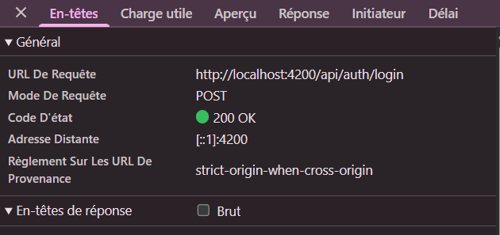
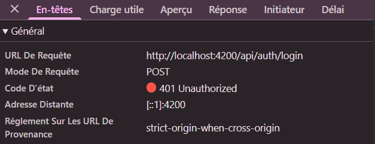
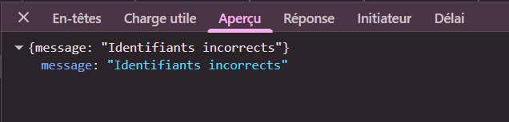
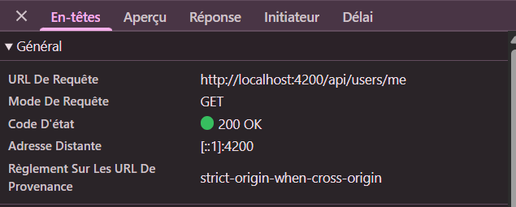
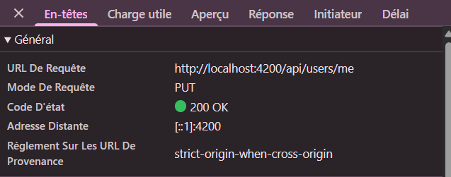
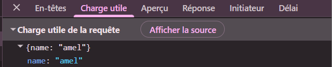
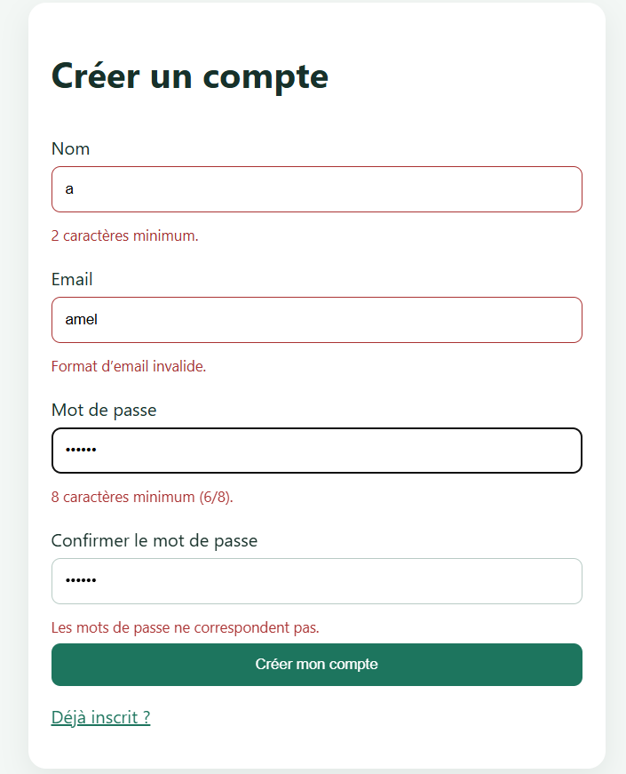

# Rapport d'usage de l'IA - TP1

## Informations générales

- **Nom** : `Amel Bakouri`
- **Assistant IA utilisé** : `Claude` 
- **Modèle** : `Opus 5.5` 

Documents liés :

- analyse détaillée produite avec l'agent : [analyse.md](analyse.md) ;
- schéma annoté du flux de connexion : [analyse.md](analyse.md), section « Mission 1 — Schéma annoté du flux de connexion » ;
- différence entre Signal et `localStorage` : même fichier, section « Signal et `localStorage` dans ce flux ».

---

## Mission 0 — Cartographier l'application

### Objectif

Comprendre l'architecture du projet avant de modifier le code : où sont le composant racine, les routes, l'enregistrement de `HttpClient`, les modèles, services et pages, et comment le JWT est ajouté aux requêtes protégées.

### Prompt principal

J'ai réutilisé le prompt du cours pour bien comprendre comment utiliser l'IA dans ce contexte, voici le prompt :

> Analyse le backend, je veux comprendre l'architecture, les workflows, les technologies et modules utilisées, comment est gérée l'authentification, comment l'upload de fichiers est gérée, comment les échanges avec la base de données sont faits, génère moi des diagrammes et des schemas et met le resultat dans analyse.md

et

> ok, mais j'aimerais que tu fasses dix critiques de ce code, par ordre de priorité / importance et que tu suggeres des améliorations à venir. En particulier sur les aspects de sécurité. Et mets à jour analyse.md, fais les critiques à la fin.

### Plan proposé par l'agent

L'agent a produit la première partie de [analyse.md](analyse.md) (« TP1 — Mission 0 : analyse du backend »), organisée en douze sections :

1. vue d'ensemble, stack technique et structure du projet ;
2. architecture globale et modèle de données Mongoose ;
3. authentification JWT, avec un diagramme de séquence « inscription puis appel à une route protégée » ;
4. upload de fichiers avec Multer, avec un diagramme de séquence ;
5. accès à MongoDB Atlas, récapitulatif des endpoints, gestion des erreurs et tests ;
6. dix critiques classées par priorité, dont trois critiques (secret JWT par défaut, validation du fichier par type MIME déclaré, absence de limite sur les tentatives de connexion).

### Cartographie retenue

| Élément demandé par le sujet | Emplacement |
|---|---|
| Composant racine | [app.ts](frontend-starter/src/app/components/app/app.ts) et [app.html](frontend-starter/src/app/components/app/app.html) |
| Configuration des routes | [routes.ts](frontend-starter/src/app/routes.ts) |
| Enregistrement de `HttpClient` | [main.ts](frontend-starter/src/main.ts) : `provideHttpClient(withInterceptors([authInterceptor]))` |
| Modèles | [shared/models/](frontend-starter/src/app/shared/models/) |
| Services | [auth.service.ts](frontend-starter/src/app/shared/services/auth.service.ts), [track.service.ts](frontend-starter/src/app/shared/services/track.service.ts) |
| Pages | [components/](frontend-starter/src/app/components/) : `login-page`, `register-page`, `profile-page`, `tracks-page` |
| Ajout du JWT aux requêtes protégées | [auth.interceptor.ts](frontend-starter/src/app/shared/interceptors/auth.interceptor.ts) |
| Protection des pages | [auth.guard.ts](frontend-starter/src/app/shared/guards/auth.guard.ts) |

Routes publiques : `GET /api/health`, `POST /api/auth/register`, `POST /api/auth/login`. Toutes les autres sont protégées par le middleware `auth` du backend ([app.js:56](backend/src/app.js#L56)).

### Fichiers effectivement modifiés

- `analyse.md` (créé dans `backend/`, puis déplacé à la racine du projet, car il couvre aussi le frontend et les TP suivants). Aucun fichier de code n'a été modifié pendant cette mission.

### Preuve de fonctionnement

- Le document [analyse.md](analyse.md) et ses diagrammes.

---

## Mission 1 — Inscription, connexion et profil

### Objectif

Compléter la partie utilisateur du frontend : formulaires réactifs d'inscription et de connexion avec validations, sauvegarde du JWT, Signal `currentUser`, redirections, déconnexion, lecture et modification du profil, et retour vers `/login` sur un `401`.

### Prompt principal

> Trouve mes formulaires d'inscription et de connexion et propose moi des formulaires réactifs et explique moi en quoi ces changements peuvent améliorer son utilisation

### Plan proposé par l'agent

L'agent a commencé par constater que les formulaires utilisaient déjà `FormGroup` et `FormControl`, mais que les validateurs n'étaient pas exploités : la requête partait même quand le formulaire était invalide, aucun message n'apparaissait sous les champs et rien n'empêchait un double envoi. Il a ensuite traité le travail en cinq parties :

| Partie | Ce qui a été proposé et réalisé |
|---|---|
| Inscription | Validateurs alignés sur le backend (nom de 2 caractères, mot de passe de 8), confirmation du mot de passe, messages sous les champs, message dédié au `409` |
| Connexion | Messages sous les champs, message dédié au `401`, champ mot de passe vidé après un échec, refus d'une réponse sans token ni utilisateur |
| Profil | Chargement automatique à l'arrivée sur `/profile`, validation du nom, états de chargement et d'enregistrement, message de succès |
| Déconnexion | Bouton dans le header, header différent selon l'état de connexion, redirection vers `/login` |
| Réponses `401` | Traitement dans l'intercepteur : nettoyage de la session et retour à `/login`, une seule fois même avec plusieurs requêtes en échec |

Le détail de chaque partie (existant vérifié, changements, flux, cas d'erreur) est dans [analyse.md](analyse.md), à partir de « TP1 — Mission 1 ».

### Erreurs ou propositions rejetées

Points relevés dans `analyse.md` :

- **Identifiants de démonstration préremplis** : l'agent les avait d'abord conservés dans le formulaire de connexion. Ils ont été retirés ensuite, car `best-practices.md` interdit de mettre un mot de passe dans le code Angular.
- **Vérification de l'expiration du token dans `authGuard`** : évoquée par l'agent mais non réalisée. Le guard vérifie seulement la présence du token ; c'est l'API qui décide de sa validité, via le `401`.
- **Retour à la page demandée après reconnexion (`returnUrl`)** : non réalisé, ce n'était pas demandé par le sujet.
- **Déconnexion côté serveur** : non réalisée, elle demanderait de modifier le backend et le contrat d'API. La déconnexion reste locale.

### Fichiers effectivement modifiés

D'après le commit `bc4fdbc` :

| Fichier | Changement |
|---|---|
| [login-page.ts](frontend-starter/src/app/components/login-page/login-page.ts), [login-page.html](frontend-starter/src/app/components/login-page/login-page.html) | Validation, messages d'erreur, état `loading` |
| [register-page.ts](frontend-starter/src/app/components/register-page/register-page.ts), [register-page.html](frontend-starter/src/app/components/register-page/register-page.html) | Validateurs, confirmation du mot de passe, gestion du `409` |
| [profile-page.ts](frontend-starter/src/app/components/profile-page/profile-page.ts), [profile-page.html](frontend-starter/src/app/components/profile-page/profile-page.html) | Chargement automatique, modification du nom, messages |
| [auth.service.ts](frontend-starter/src/app/shared/services/auth.service.ts) | Refus d'une réponse incomplète, réponse de profil ignorée après déconnexion |
| [auth.interceptor.ts](frontend-starter/src/app/shared/interceptors/auth.interceptor.ts) | Traitement du `401` |
| [app.ts](frontend-starter/src/app/components/app/app.ts), [app.html](frontend-starter/src/app/components/app/app.html) | Bouton de déconnexion, header selon l'état de connexion |
| [tracks-page.ts](frontend-starter/src/app/components/tracks-page/tracks-page.ts) | Libération de l'audio en mémoire quand la page est quittée |
| [styles.css](frontend-starter/src/styles.css) | Styles des messages d'erreur et de succès, bouton de déconnexion |

Non modifiés : `auth.guard.ts`, `routes.ts`, `main.ts` et tout le backend.

### Preuve de fonctionnement

Connexion réussie :

Connexion refusée :

Lecture du profil, avec l'en-tête `Authorization` (token masqué) :

Modification du nom :

Validations du formulaire d'inscription :

### Réponses aux questions du sujet

**Quelles routes du backend sont utilisées ?**

| Route | Appelée depuis | Protégée |
|---|---|---|
| `POST /api/auth/register` | `AuthService.register()` | non |
| `POST /api/auth/login` | `AuthService.login()` | non |
| `GET /api/users/me` | `AuthService.profile()` | oui |
| `PUT /api/users/me` | `AuthService.update()` | oui |
| `GET /api/tracks?page=&limit=` | `TrackService` | oui |
| `POST /api/tracks` | `TrackService` | oui |
| `GET /api/tracks/:id/audio` | `TrackService` | oui |

`GET /api/health` sert seulement à tester le backend à la main. `DELETE /api/tracks/:id` existe côté backend mais n'est pas appelée par le frontend.

**Où s'effectue la mise à jour du profil utilisateur ?**

| Côté | Fichier | Rôle |
|---|---|---|
| Front | [profile-page.html](frontend-starter/src/app/components/profile-page/profile-page.html) | Formulaire, `(ngSubmit)="save()"` |
| Front | [profile-page.ts](frontend-starter/src/app/components/profile-page/profile-page.ts) | `save()` valide le nom puis appelle le service |
| Front | [auth.service.ts:33](frontend-starter/src/app/shared/services/auth.service.ts#L33) | `update()` envoie `PUT /api/users/me` et met à jour `currentUser` |
| Front | [auth.interceptor.ts](frontend-starter/src/app/shared/interceptors/auth.interceptor.ts) | Ajoute `Authorization: Bearer …` |
| Back | [app.js:56](backend/src/app.js#L56) | Middleware `auth` : vérifie le JWT |
| Back | [app.js:249](backend/src/app.js#L249) | Route `PUT /api/users/me` : modifie le nom |
| Back | [User.js](backend/src/models/User.js) | Modèle Mongoose : règles de validation du nom, écriture dans MongoDB |

**Quel modèle utilisez-vous ? Comment savoir combien de tokens ont été consommés ? Qui peut conseiller le meilleur modèle pour une tâche ?**

- **Modèle utilisé** : Claude Opus 5.5, via l'extension Claude Code de VS Code. La commande `/model` affiche le modèle actif et permet d'en changer.
- **Tokens consommés** : dans Claude Code, la commande `/cost` affiche les tokens consommés par la session (entrée, sortie, cache) et le coût estimé. Avec un abonnement, `/usage` montre plutôt la part utilisée des limites du forfait.
- **Choisir le meilleur modèle** : la documentation d'Anthropic compare les modèles (capacités, vitesse, prix), et l'agent lui-même peut conseiller selon la tâche. En pratique, un modèle rapide et peu coûteux (Haiku) suffit pour des tâches simples et répétitives ; un modèle plus puissant (Opus) est préférable pour l'analyse d'architecture et le raisonnement sur plusieurs fichiers, comme dans ce TP. C'est à moi de faire le choix final, selon le coût et la qualité attendue.
