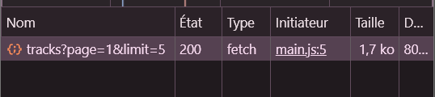
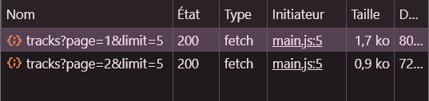
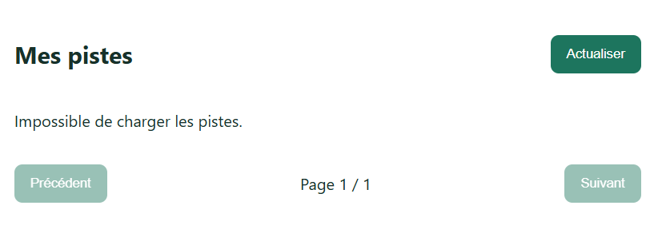
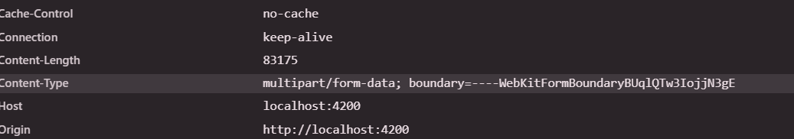
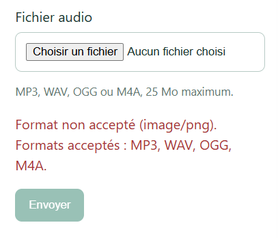
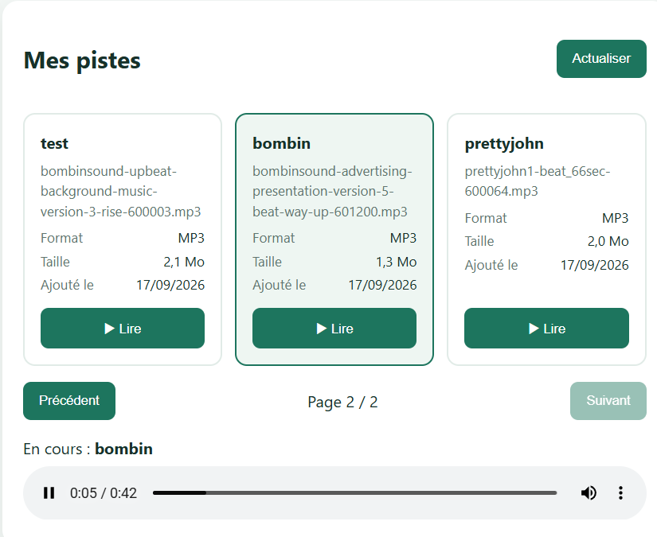
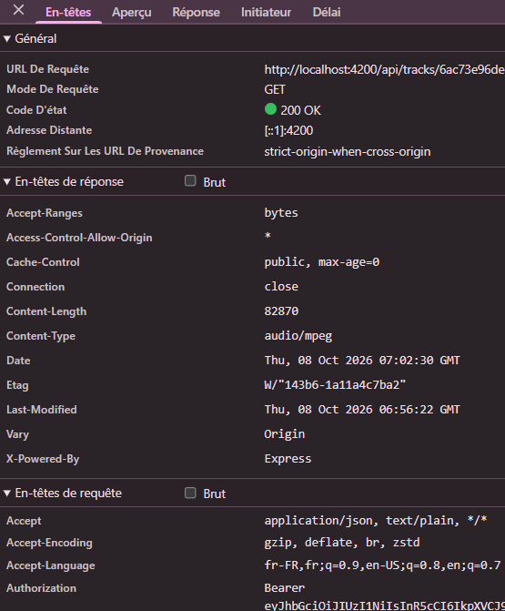
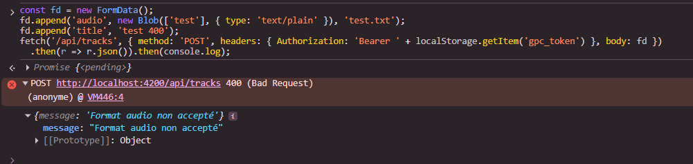
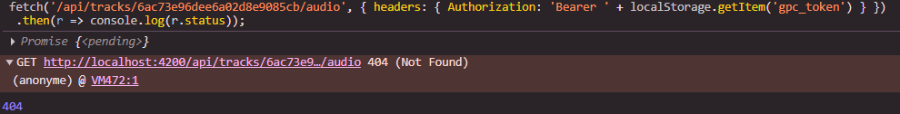

# Rapport d'usage de l'IA - TP2

## Informations générales

- **Nom** : `Amel Bakouri`
- **Assistant IA utilisé** : `Claude Code` (extension VS Code)
- **Modèle** : `Opus 5.5`

Document lié : analyse détaillée produite avec l'agent dans [analyse.md](analyse.md), partie « TP2 » à la fin du fichier. On y trouve les schémas annotés de l'upload et de la lecture, les cas d'erreur, les corrections après relecture et les réponses détaillées sur la mémoire, le buffering et le streaming.

Méthode suivie pour ce TP : d'abord demander une **analyse sans modification**, valider le diagnostic, puis demander une implémentation **limitée à des fichiers nommés**, avec le diff et une explication ligne par ligne.

---

## Mission 2 — Bibliothèque paginée

### Objectif

Afficher la bibliothèque avec une **pagination serveur** : le flux `composant → TrackService → HttpClient → GET /api/tracks?page=...&limit=...` doit transmettre réellement `page` et `limit`, l'état doit être porté par des Signals (`tracks`, `page`, `pages`, `loading`, erreur), l'affichage doit utiliser `@for` / `@empty` / `@if`, et les boutons « Précédent » / « Suivant » doivent être désactivés aux bornes. Chaque changement de page doit déclencher une nouvelle requête HTTP, sans découpage local. Le backend ne doit pas être modifié.

### Prompts principaux

Trois prompts, dans cet ordre.

**1. Analyse sans modification**

> Tu es mon assistant pour ce projet Angular 22. Lis le frontend-starter/CLAUDE.md, AGENTS.md, best-practices.md et API_CONTRACT.md.
> - Analyse tracks-page.ts/html et track.service.ts, et décris le flux composant → TrackService → HttpClient → GET /api/tracks?page&limit.
> - Compare avec les exigences suivantes : signals tracks/page/pages/loading/error, @for/@empty/@if, boutons « Précédent »/« Suivant » désactivés aux bornes, une nouvelle requête HTTP à chaque changement de page, pas de découpage local.
> - Liste précisément ce qui manque ou est incorrect.
> Ne modifie pas le backend et attends ma validation.

**2. Relecture de mon propre prompt d'implémentation**

J'avais préparé le prompt suivant et j'ai demandé à l'agent s'il couvrait les problèmes qu'il avait listés :

> Maintenant implémente uniquement dans tracks-page.ts/html :
> - un signal error (string | null) affiché avec @if et role="alert" ;
> - go(page) qui ignore les pages hors [1, pages()] ;
> - les boutons « Précédent »/« Suivant » désactivés aux bornes ET pendant loading() ;
> - reset de error au début de load().
> Garde TrackService tel quel. Montre-moi le diff et explique chaque ligne.

**3. Implémentation de la version complétée par l'agent, que j'ai validée**

> Implémente uniquement dans tracks-page.ts/html, TrackService inchangé :
> - un signal `error` (`string | null`), remis à `null` au début de `load()`, renseigné dans le callback `error` de `load()` (avec vidage de `tracks`), affiché avec `@if` et `role="alert"` ;
> - `go(page)` ignore les pages hors [1, pages()] ;
> - boutons renommés « Précédent »/« Suivant », désactivés si `page() <= 1` / `page() >= pages()` ET pendant `loading()` ;
> - structure exclusive : `@if (loading())` avec `role="status"`, sinon `@for … @empty` ;
> - « Actualiser » désactivé pendant `loading()`.
> Montre-moi le diff et explique chaque ligne.

### Plan proposé par l'agent

**Flux constaté avant modification**

```
TracksPageComponent (constructor → load())
  → loading.set(true)
  → TrackService.list(this.page())            // limit = 5 par défaut
    → HttpClient.get<Page<Track>>('/api/tracks', { params: { page, limit } })
      → authInterceptor ajoute Authorization: Bearer <token>
      → proxy.conf.json : /api → http://localhost:3000
        → backend : skip((page-1)*limit).limit(limit) → { items, page, limit, total, pages }
  ← next  : tracks.set(items), pages.set(pages), loading.set(false)
  ← error : console.error + loading.set(false)
```

**Déjà conforme** : Signals `tracks`, `page`, `pages`, `loading` ; `TrackService.list()` transmet `page` et `limit` en query params ; `@for` avec `track track.id`, `@empty`, `@if (loading())` ; `go()` relance une requête HTTP ; aucun découpage local (le découpage est fait par MongoDB avec `skip` / `limit`, [app.js:286-289](backend/src/app.js#L286-L289)).

**Problèmes relevés par l'agent**

| # | Problème | Traité |
|---|---|---|
| 1 | Pas de Signal `error` | ✅ |
| 2 | Erreur jamais affichée à l'utilisateur | ✅ |
| 3 | Libellés « Préc. » / « Suiv. » au lieu de « Précédent » / « Suivant » | ✅ |
| 4 | « Chargement… » et « Aucune piste. » affichés en même temps au premier chargement | ✅ |
| 5 | Borne `page() === pages()` fragile : « Suivant » reste actif si `page` dépasse `pages` | ✅ |
| 6 | `go()` n'a aucune garde, seul le `[disabled]` du template protège | ✅ |
| 7 | Après une erreur, `tracks` garde les pistes de l'ancienne page | ✅ |
| 8 | Clics rapides : plusieurs requêtes en parallèle, réponses possiblement dans le désordre | ⚠️ Partiel (boutons désactivés pendant `loading()`) |
| 9 | `response.page` renvoyé par le serveur n'est pas utilisé | ❌ Non traité |
| 10 | Pas de `role="status"` / `role="alert"` (WCAG) | ✅ |
| 11 | `{{ track.size }} Ko` affiche des octets | ➡️ Corrigé en Mission 3 (`formatSize()`) |
| 12 | Erreurs d'upload et de lecture non affichées | ➡️ Corrigé en Mission 3 |

**Analyse de mon prompt (étape 2)** : l'agent a indiqué qu'il couvrait les points 1, 2 et 6, partiellement 3, 5 et 8, mais pas les points 4, 7 et 10, et qu'il ne disait pas explicitement de **renseigner** `error` dans le callback d'erreur. Il a proposé la version complétée ci-dessus, que j'ai retenue.

### Diff appliqué

[tracks-page.ts](frontend-starter/src/app/components/tracks-page/tracks-page.ts) :

```diff
   readonly loading = signal(false);
+  readonly error = signal<string | null>(null);

   load(): void {
     this.loading.set(true);
+    this.error.set(null);
     this.service.list(this.page()).subscribe({
       ...
       error: (error) => {
         console.error('[TracksPage] Chargement impossible', error);
+        this.tracks.set([]);
+        this.error.set('Impossible de charger les pistes.');
         this.loading.set(false);
       },

   go(page: number): void {
+    if (page < 1 || page > this.pages()) return;
     this.page.set(page);
     this.load();
   }
```

[tracks-page.html](frontend-starter/src/app/components/tracks-page/tracks-page.html) :

```diff
-<button type="button" (click)="load()">Actualiser</button>
+<button type="button" (click)="load()" [disabled]="loading()">Actualiser</button>

+@if (error()) {
+  <p role="alert">{{ error() }}</p>
+}
+@if (loading()) {
+  <p role="status">Chargement…</p>
+} @else {
   @for (track of tracks(); track track.id) { … }
   @empty {
+    @if (!error()) {
       <p>Aucune piste.</p>
+    }
   }
+}

-<button … [disabled]="page() === 1">Préc.</button>
+<button … [disabled]="loading() || page() <= 1">Précédent</button>
-<button … [disabled]="page() === pages()">Suiv.</button>
+<button … [disabled]="loading() || page() >= pages()">Suivant</button>
```

Explication des choix :

- `error.set(null)` au début de `load()` : une ancienne erreur disparaît dès qu'on réessaie.
- `tracks.set([])` en cas d'erreur : évite d'afficher les pistes de l'ancienne page sous le numéro de la nouvelle.
- Garde dans `go()` : la règle des bornes est dans le composant, pas seulement dans le template ; aucune requête ne part vers une page invalide.
- `<=` / `>=` au lieu de `===` : « Suivant » reste désactivé même si `page` dépasse `pages` (par exemple après une suppression).
- `loading() ||` sur les boutons : empêche les doubles clics et les réponses reçues dans le désordre.
- Structure `@if / @else` : le chargement et la liste ne s'affichent jamais en même temps.
- `role="alert"` annonce immédiatement l'erreur aux lecteurs d'écran, `role="status"` annonce le chargement sans interrompre.

### Vérifications réalisées

- `npm run build` : compilation sans erreur (lancé par l'agent après la modification).
- Relecture du backend [app.js:271-316](backend/src/app.js#L271-L316) : la pagination est faite côté serveur (`skip` / `limit`), `limit` est borné entre 1 et 20, et `pages` vaut au minimum 1. Cela justifie que `page() >= pages()` suffit pour désactiver « Suivant ».

Tests effectués dans le navigateur :

- Network : l'arrivée sur la bibliothèque envoie `GET /api/tracks?page=1&limit=5`
- Network : chaque clic sur « Suivant » / « Précédent » envoie une **nouvelle** requête avec le bon `page`
- Network : la requête contient l'en-tête `Authorization: Bearer …`
- « Précédent » est grisé en page 1, « Suivant » est grisé sur la dernière page
- Les boutons sont grisés pendant le chargement (testé avec Network > Throttling « Slow 3G »)
- Backend arrêté puis « Actualiser » : le message « Impossible de charger les pistes. » s'affiche, sans « Aucune piste. »
- Compte sans piste : seul « Aucune piste. » s'affiche, pas de « Chargement… » en même temps

### Erreurs ou propositions rejetées

- **Mon premier prompt d'implémentation était incomplet** : il ne demandait ni de remplir `error` en cas d'échec, ni de séparer chargement et état vide, ni de vider la liste après une erreur. L'agent l'a relevé avant de coder et j'ai choisi la version complétée.
- **Ajout non demandé par l'agent** : `@if (!error())` dans le `@empty`. Je l'ai gardé, car sans lui l'erreur et « Aucune piste. » s'affichent ensemble, ce qui est contradictoire.
- **Non retenus pour cette mission** : synchronisation de `page` sur `response.page`, correction de l'unité « Ko », affichage des erreurs d'upload et de lecture. Ils relèvent de la Mission 3 ou ne sont pas demandés.
- **Limite connue** : `upload()` peut encore appeler `load()` pendant un chargement en cours. Risque faible, non traité.
- **Options AVANCÉ non réalisées** : Paginator Angular Material et pagination avec `aggregate-paginate-v2`. La seconde aurait imposé de modifier le backend et `API_CONTRACT.md`.

### Fichiers effectivement modifiés

| Fichier | Changement |
|---|---|
| [tracks-page.ts](frontend-starter/src/app/components/tracks-page/tracks-page.ts) | Signal `error`, reset dans `load()`, vidage de `tracks` en cas d'erreur, garde dans `go()` |
| [tracks-page.html](frontend-starter/src/app/components/tracks-page/tracks-page.html) | Message d'erreur, structure `@if / @else`, libellés et bornes des boutons, désactivation pendant `loading()` |

Non modifiés : [track.service.ts](frontend-starter/src/app/shared/services/track.service.ts) (déjà conforme), `API_CONTRACT.md` et tout le backend.

### Preuve de fonctionnement

Première page :



Changement de page, nouvelle requête :



Boutons désactivés aux bornes :


Erreur de chargement affichée :



---

## Mission 3 — Analyse et amélioration de l'upload et de la lecture audio

### Objectif

Comprendre le mécanisme d'upload et de lecture sécurisée **déjà fourni**, puis compléter uniquement ce qui manque côté frontend : validation du fichier avant l'envoi, états et messages pendant l'envoi, cards de bibliothèque, affichage du morceau en cours et des erreurs de lecture. Le backend, `TrackService` et `API_CONTRACT.md` ne doivent pas être modifiés.

### Prompts retenus

J'ai choisi ces cinq prompts pour les raisons suivantes :

- **Un prompt par étape du sujet** (analyse, validation, envoi, cards, lecture) : chaque diff reste petit, je peux le relire en entier et tester une seule chose à la fois.
- **Analyse d'abord, sans modification** : le sujet demande de ne pas réimplémenter l'existant. Il fallait donc repérer ce qui marchait déjà (FormData, Blob, révocation) avant de toucher au code.
- **Périmètre explicite** : seulement les fichiers `tracks-page`, avec `TrackService`, backend et `API_CONTRACT.md` inchangés. Cela évite que l'agent modifie le contrat HTTP ou le service partagé.
- **Contraintes précises plutôt que vagues** : « les mêmes types que `allowed` dans app.js », « `role="alert"` », « vider aussi le champ `<input type="file">` ». Une demande comme « améliore l'upload » aurait donné un résultat difficile à vérifier.
- **« Montre le diff et explique chaque ligne »** : je dois pouvoir expliquer chaque modification sans l'agent.

C'est la même méthode qu'en Mission 2, où un prompt trop vague m'avait fait oublier plusieurs cas (erreur non renseignée, chargement et état vide affichés ensemble).

**1. Analyse sans modification**

> Analyse sans rien modifier :
> - repère dans quels fichiers et méthodes se trouvent : le choix du fichier, la construction du FormData, l'appel HTTP d'upload, la récupération du Blob, la création de l'ObjectURL, l'affectation au lecteur `<audio>` et la révocation de l'ancienne URL ;
> - décris les flux composant → TrackService → HttpClient → API, puis API → Blob → ObjectURL → `<audio>` ;
> - montre où l'intercepteur ajoute le JWT et explique pourquoi une URL placée directement dans `src` ne reçoit pas ce header ;
> - repère dans backend/src/app.js les contrôles du champ `audio`, du `title`, des formats et des 25 Mo, et vérifie que le FormData utilise exactement `audio` et `title` ;
> - liste ce qui manque côté frontend pour l'upload, les cards et la lecture.
> Ne modifie ni le backend, ni TrackService, ni API_CONTRACT.md. Attends ma validation.

**2. Validation du fichier avant envoi**

> Implémente uniquement dans tracks-page.ts/html :
> - transforme `file` en signal `File | null` ;
> - ajoute les constantes des types MIME acceptés (les mêmes que `allowed` dans backend/src/app.js) et de la taille maximale de 25 Mo ;
> - dans `choose()`, refuse un fichier au mauvais format ou trop gros : `file` reste à `null` et un signal `uploadError` affiche un message clair (format refusé ou taille dépassée) avec `role="alert"` ;
> - restreins `accept` à `.mp3,.wav,.ogg,.m4a`.
> TrackService inchangé. Montre le diff et explique chaque ligne. Explique aussi pourquoi cette validation ne remplace pas celle du backend.

**3. États pendant l'envoi**

> Implémente uniquement dans tracks-page.ts/html :
> - un signal `uploading` : bouton « Envoyer » désactivé si aucun fichier n'est choisi ou pendant l'envoi, avec le libellé « Envoi… » pendant l'envoi ;
> - une garde dans `upload()` contre la double soumission ;
> - en cas d'erreur, afficher le message du serveur (`error.error?.message`), ou un message de secours, dans `uploadError` ;
> - en cas de succès, afficher un message `uploadSuccess` avec `role="status"`, vider le titre, le signal `file` **et le champ `<input type="file">`**, puis recharger la page 1 ;
> - remettre les messages à zéro au début d'un nouvel envoi ou d'un nouveau choix de fichier.
> Montre le diff et explique chaque ligne.

**4. Cards responsives et accessibles**

> Dans tracks-page.html/css uniquement, remplace la liste actuelle par des cards :
> - une liste sémantique `<ul>`/`<li>`, en grille responsive (une colonne sur mobile) ;
> - chaque card affiche le titre (`<h3>`), le nom original, le format (déduit de `mimeType`), la taille lisible en Ko ou Mo (la valeur `size` est en octets) et la date d'ajout avec le pipe `date` ;
> - le bouton de lecture garde son `aria-label`, avec un focus clavier visible et un contraste conforme WCAG AA ;
> - conserve `@for` / `@empty` et la pagination de la Mission 2.
> Montre le diff et explique chaque ligne.

**5. Lecture audio**

> Implémente uniquement dans tracks-page.ts/html/css :
> - un signal `currentTrack`, affiché sous la forme « En cours : titre » au-dessus du lecteur, la card active étant mise en évidence ;
> - un signal `audioLoading` : boutons ▶ désactivés pendant le téléchargement du Blob ;
> - un signal `audioError` affiché avec `role="alert"` : message compréhensible en cas d'erreur HTTP (404, réseau) et sur l'événement `(error)` de `<audio>` ;
> - garder la révocation de l'ancienne ObjectURL et de l'URL finale à la destruction du composant.
> Montre le diff et explique chaque ligne.

### Analyse produite par l'agent

**Où se trouve chaque étape**

| Étape | Fichier et méthode |
|---|---|
| Choix du fichier | [tracks-page.html](frontend-starter/src/app/components/tracks-page/tracks-page.html) `(change)="choose($event)"` puis `choose()` dans [tracks-page.ts](frontend-starter/src/app/components/tracks-page/tracks-page.ts) |
| Construction du `FormData` | [track.service.ts:17-21](frontend-starter/src/app/shared/services/track.service.ts#L17-L21) `upload()` : `append('audio', file)` et `append('title', title)` |
| Appel HTTP d'upload | même méthode, `http.post<Track>('/api/tracks', body)` |
| Récupération du `Blob` | [track.service.ts:24-28](frontend-starter/src/app/shared/services/track.service.ts#L24-L28) `audio()` avec `responseType: 'blob'` |
| Création de l'`ObjectURL` | `play()` : `URL.createObjectURL(blob)` |
| Affectation au lecteur | `<audio [src]="audioUrl()">` |
| Révocation | `play()` révoque l'URL précédente, et `DestroyRef.onDestroy` révoque la dernière (ajouté au TP1) |

**Flux d'upload**

```
choose() → file → upload() → TrackService.upload() → FormData {audio, title}
  → HttpClient.post → authInterceptor (+ Bearer) → POST /api/tracks (multipart)
  → auth → multer upload.single("audio") → disque + Track.create() → 201 Track
```

**Flux de lecture**

```
play(track) → TrackService.audio(id) → HttpClient.get(blob) → authInterceptor (+ Bearer)
  → GET /api/tracks/:id/audio → findOne({_id, ownerId}) → res.sendFile (flux depuis le disque)
  ← Blob complet → URL.createObjectURL → audioUrl() → <audio [src]>
```

**L'intercepteur et l'attribut `src`** : [auth.interceptor.ts](frontend-starter/src/app/shared/interceptors/auth.interceptor.ts), enregistré dans [main.ts](frontend-starter/src/main.ts) avec `withInterceptors([authInterceptor])`, n'agit que sur les requêtes passées par `HttpClient`. Avec `<audio src="/api/tracks/id/audio">`, c'est le navigateur qui télécharge lui-même le fichier, sans passer par Angular. Il n'ajoute jamais d'en-tête `Authorization` de son propre chef (seulement des cookies), donc le middleware `auth` répond `401` ([app.js:62-64](backend/src/app.js#L62-L64)). C'est pour cela que le fichier est téléchargé en `Blob` par `HttpClient`, puis donné au lecteur sous forme d'`ObjectURL` locale.

**Contrôles du backend**

| Contrôle | Emplacement |
|---|---|
| Champ fichier `audio` | [app.js:337](backend/src/app.js#L337) `upload.single("audio")` |
| Fichier absent → `400` | [app.js:340-343](backend/src/app.js#L340-L343) |
| Champ `title` (repli sur le nom du fichier) | [app.js:347](backend/src/app.js#L347) |
| Types MIME acceptés | [app.js:34-41](backend/src/app.js#L34-L41) et `fileFilter` [app.js:109-119](backend/src/app.js#L109-L119) |
| 25 Mo maximum | [app.js:31](backend/src/app.js#L31) et `limits` [app.js:108](backend/src/app.js#L108) |
| Ces erreurs deviennent un `400 {message}` | [app.js:445-450](backend/src/app.js#L445-L450) |
| Lecture réservée au propriétaire (`404` sinon) | [app.js:381-389](backend/src/app.js#L381-L389) |

Le `FormData` du frontend utilise bien exactement `audio` et `title` : aucune modification n'était nécessaire.

**Manques relevés**

| # | Manque | Traité |
|---|---|---|
| 1 | Pas de vérification du type ni de la taille avant l'envoi ; `accept="audio/*"` trop large | ✅ |
| 2 | Pas d'état « envoi en cours », double soumission possible | ✅ |
| 3 | Erreurs serveur seulement dans la console | ✅ |
| 4 | Pas de message de succès | ✅ |
| 5 | Le champ `<input type="file">` garde le nom du fichier après l'envoi | ✅ |
| 6 | `file` est une propriété classique, pas un Signal | ✅ |
| 7 | Lignes au lieu de cards ; format et date absents ; taille en octets affichée « Ko » | ✅ |
| 8 | Morceau en cours non indiqué | ✅ |
| 9 | Erreurs de lecture non affichées (HTTP et décodage) | ✅ |
| 10 | Plusieurs clics sur ▶ lancent plusieurs téléchargements | ✅ |
| 11 | Révocation de l'URL finale à la destruction | Déjà en place (TP1) |

### Ce qui a été implémenté

[tracks-page.ts](frontend-starter/src/app/components/tracks-page/tracks-page.ts)

- **Constantes `ALLOWED_TYPES` et `MAX_SIZE`** : la même liste de types MIME et la même limite de 25 Mo que le backend. `ALLOWED_TYPES` associe aussi chaque type à son format affiché (MP3, WAV, OGG, M4A).
- **`choose()`** : remet les messages à zéro et refuse un fichier dont `file.type` n'est pas dans la liste ou qui dépasse 25 Mo. Dans ce cas, un message précis s'affiche et le champ est vidé (`rejectFile()`).
- **`upload()`** :
  - ne fait rien sans fichier ou pendant un envoi (garde contre la double soumission) ;
  - passe `uploading` à `true` ;
  - en cas de succès : message, vidage du titre et du fichier (`clearFile()`), rechargement de la page 1 ;
  - en cas d'erreur : message du serveur via `serverMessage()`.
- **`clearFile()`** : remet le Signal à `null` **et** vide le champ natif grâce à `viewChild('fileInput')`. Le Signal seul ne suffit pas, car le navigateur garderait le nom du fichier affiché.
- **`serverMessage()`** :
  - statut `0` : « Serveur injoignable » ;
  - si le corps contient `error.error.message` (par exemple « Format audio non accepté »), ce message est affiché ;
  - sinon, un message de secours.
- **`play()`** :
  - ne fait rien si un téléchargement est déjà en cours ;
  - passe `audioLoading` à `true` ;
  - en cas de succès : `currentTrack` est mis à jour en même temps que l'URL ;
  - en cas d'erreur : message selon le statut. Avec `responseType: 'blob'`, le corps d'une erreur est lui aussi un `Blob` : on ne peut pas lire `error.error.message`, d'où l'utilisation du statut (`404` : introuvable ou pas à vous, `0` : serveur injoignable).
  - `takeUntilDestroyed(this.destroyRef)` : si on quitte la page pendant le téléchargement, la réponse est ignorée et aucune `ObjectURL` orpheline n'est créée.
- **`audioFailed()`** : appelée par l'événement `(error)` de `<audio>` quand le navigateur n'arrive pas à décoder le fichier.
- **`formatOf()` et `formatSize()`** : format lisible et taille en Ko ou Mo (la valeur `size` du backend est en octets).

[tracks-page.html](frontend-starter/src/app/components/tracks-page/tracks-page.html)

- `accept=".mp3,.wav,.ogg,.m4a"` et une aide « MP3, WAV, OGG ou M4A, 25 Mo maximum ».
- Messages `uploadError` (`role="alert"`) et `uploadSuccess` (`role="status"`).
- Bouton `[disabled]="!file() || uploading()"`, avec le libellé « Envoi… » pendant l'envoi.
- Cards dans une liste `<ul class="track-list">` : un `<li>` par piste avec le titre en `<h3>`, le nom original, et une liste `<dl>` format / taille / date (`<time>` et pipe `date`).
- Card en cours de lecture mise en évidence avec `[class.active]`.
- `@for` / `@empty` conservés. L'état vide est un `<li>` pour rester du HTML valide dans un `<ul>`.
- Boutons ▶ désactivés pendant `audioLoading()`.
- Zone lecteur : « Téléchargement du morceau… », erreur audio, puis « En cours : titre » et `<audio (error)="audioFailed()">` avec un `aria-label`.

[tracks-page.css](frontend-starter/src/app/components/tracks-page/tracks-page.css)

- Grille `repeat(auto-fill, minmax(190px, 1fr))` : trois colonnes environ sur ordinateur, une seule sur mobile.
- Bordure et fond pour la card active.
- `button:focus-visible` avec un contour net pour la navigation au clavier.
- Couleurs reprises de `styles.css` : texte secondaire `#61756f` sur blanc (contraste d'environ 4,9:1) et bouton blanc sur `#1d755e` (environ 5,6:1), soit au-dessus du minimum AA de 4,5:1.

### Pourquoi la validation frontend ne remplace pas celle du backend

La validation frontend **améliore l'expérience** : le message est immédiat, et on n'envoie pas 30 Mo pour se faire refuser à la fin. Mais elle **ne protège rien** :

- n'importe qui peut appeler `POST /api/tracks` directement (curl, Postman, script) sans passer par Angular ;
- le code du frontend s'exécute chez l'utilisateur, qui peut le modifier depuis les DevTools ;
- `file.type` est le type annoncé par le système d'exploitation selon l'extension, pas le contenu réel du fichier.

Le backend reste donc la seule barrière fiable. Le frontend reprend les mêmes règles pour que les deux côtés soient cohérents.

### Vérifications réalisées

- `npm run build` : compilation sans erreur (lancé par l'agent).
- `GET /api/health` → `{"status":"ok"}` : le backend tournait pendant le travail.
- Relecture de [app.js](backend/src/app.js) : la liste des types MIME et la limite de 25 Mo du frontend sont identiques à celles du backend.

Tests effectués dans le navigateur :

- Network : `POST /api/tracks`, en-tête `Content-Type: multipart/form-data; boundary=…`, et dans « Charge utile » les champs `audio` (binaire) et `title`
- Upload de `fichiers-audio-de-test/song1.mp3` : bouton « Envoi… » grisé, puis message de succès, champ fichier vidé, retour en page 1 avec la nouvelle card
- Fichier `.txt` ou `.png` choisi : message « Format non accepté », **aucune requête** dans Network
- `400` côté serveur. Renommer un `.txt` en `.mp3` **ne marche pas** : Windows l'annonce `audio/mpeg`, et le backend l'accepte (voir « Erreurs ou propositions rejetées »). J'ai donc contourné la validation Angular depuis la console des DevTools :
  ```js
  const fd = new FormData();
  fd.append('audio', new Blob(['test'], { type: 'text/plain' }), 'test.txt');
  fd.append('title', 'test 400');
  fetch('/api/tracks', { method: 'POST', headers: { Authorization: 'Bearer ' + localStorage.getItem('gpc_token') }, body: fd })
    .then(r => r.json()).then(console.log);
  ```
  Résultat dans Network : `400 {"message":"Format audio non accepté"}`. Le token n'est pas affiché par cette commande, et les en-têtes de requête n'apparaissent pas sur la capture.
- Lecture : `GET /api/tracks/:id/audio`, en-tête de réponse `Content-Type: audio/mpeg`, présence de `Authorization: Bearer …` dans la requête
- « En cours : titre » affiché et card mise en évidence
- Lecture réservée au propriétaire : avec un second compte, appel de l'id d'une piste du premier compte → `404`
- Cards sur mobile (DevTools, mode responsive) : une seule colonne
- Navigation au clavier (Tab) : contour visible sur les boutons

### Erreurs ou propositions rejetées

- **Limite de la validation par type MIME** : un fichier texte renommé en `.mp3` est annoncé `audio/mpeg` par Windows. Il passe donc la validation frontend **et** celle du backend, qui ne contrôle aussi que le type annoncé. Seule l'erreur de décodage de `<audio>` le détecte, au moment de la lecture. Vérifier le contenu réel (les premiers octets du fichier) demanderait de modifier le backend : ce n'est pas fait ici.
- **Message d'erreur de lecture** : la première idée était de réutiliser `error.error.message` comme pour l'upload. Avec `responseType: 'blob'`, ce corps est un `Blob` illisible directement, donc le message est construit à partir du statut HTTP.
- **Ajouts de l'agent non prévus dans les prompts** :
  - `takeUntilDestroyed` sur le téléchargement audio, pour éviter une `ObjectURL` jamais révoquée si on quitte la page ;
  - l'état vide en `<li>`, pour rester du HTML valide ;
  - `Object.hasOwn` au lieu de l'opérateur `in`, qui accepterait aussi des clés héritées comme `constructor`.
- **Non réalisés (facultatifs ou avancés)** : barre de progression de l'upload, suppression avec confirmation, filtre par titre, image de couverture.
- **`TrackService` non modifié** : son contrat était déjà correct.

### Corrections après relecture du code

Une fois les Missions 2 et 3 terminées, j'ai fait vérifier par l'agent que le code couvrait tout le sujet. Toutes les exigences étaient couvertes et `npm run build` passait, mais il a relevé trois défauts, que j'ai fait corriger.

**Défauts relevés et corrections**

| # | Défaut | Scénario | Correction dans [tracks-page.ts](frontend-starter/src/app/components/tracks-page/tracks-page.ts) |
|---|---|---|---|
| 1 | Titre composé uniquement d'espaces | `"   "` est envoyé tel quel. Mongoose fait un `trim` ([Track.js](backend/src/models/Track.js), `title: { required, trim }`), le titre devient vide et `required` échoue : `400` avec un message technique de Mongoose | `upload()` envoie `this.title.value.trim() \|\| file.name` : un titre vide ou fait d'espaces est remplacé par le nom du fichier |
| 2 | Fichier sans type MIME | Sous Windows, une extension associée à aucun programme donne `file.type === ''`. Le message affiché était « Format non accepté (inconnu) », peu clair | `choose()` traite ce cas à part avec le message « Type de fichier non reconnu par votre navigateur » |
| 3 | Page devenue vide | Si le nombre de pages diminue alors qu'on est sur la dernière (pistes supprimées depuis un autre onglet), le serveur renvoie `items: []` et la page reste vide, avec « Suivant » grisé | Dans `load()`, si `page() > response.pages`, on passe à la dernière page existante et on recharge |

**Proposition de l'agent rejetée** : pour le défaut 2, le plan initial de l'agent proposait d'**accepter le fichier d'après son extension** (`.mp3`, `.wav`…) quand `file.type` est vide. En relisant le backend, cette idée ne tient pas :

- quand un fichier n'a pas de type, le navigateur l'envoie dans le multipart avec `Content-Type: application/octet-stream` ;
- Multer remplit `file.mimetype` avec cette valeur, et `fileFilter` ([app.js:109-119](backend/src/app.js#L109-L119)) la refuse ;
- le fichier serait donc accepté par Angular puis refusé par le serveur avec un `400`.

La validation frontend doit reprendre **exactement** les règles du backend. Sinon, elle laisse passer un fichier qui sera refusé ensuite, ce qui est pire qu'un refus immédiat.

**Vérification** : `npm run build` passe sans erreur après ces trois corrections (lancé par l'agent).

Tests effectués dans le navigateur :

- Titre `"   "` + `song1.mp3` : la card affiche « song1.mp3 » comme titre, pas d'erreur `400`
- Défaut 3 : deux onglets ouverts. dans le premier, dernière page affichée ; pistes supprimées dans MongoDB Atlas ; clic sur « Actualiser » dans le premier : la dernière page existante s'affiche

### Fichiers effectivement modifiés

| Fichier | Changement |
|---|---|
| [tracks-page.ts](frontend-starter/src/app/components/tracks-page/tracks-page.ts) | Validation du fichier, Signals d'upload et de lecture, messages d'erreur et de succès, formatage du format et de la taille. Après relecture : titre nettoyé, fichier sans type, retour à la dernière page existante |
| [tracks-page.html](frontend-starter/src/app/components/tracks-page/tracks-page.html) | Messages, bouton d'envoi, cards, morceau en cours, erreur audio |
| [tracks-page.css](frontend-starter/src/app/components/tracks-page/tracks-page.css) | Grille de cards responsive, card active, focus visible |
| [tsconfig.app.json](frontend-starter/tsconfig.app.json) | Ajout de `"rootDir": "./src"` |

**Pourquoi `rootDir` ?** Sans cette ligne, VS Code affiche une erreur sur `tsconfig.app.json` :

```
error TS5011: The common source directory of 'tsconfig.app.json' is './src'.
The 'rootDir' setting must be explicitly set to this or another path to adjust your output's file layout.
```

C'est une règle nouvelle de **TypeScript 6.0** (le projet utilise la 6.0.3). Quand `outDir` est défini, `rootDir` doit être écrit explicitement. Avant la version 6, TypeScript le déduisait : c'était le dossier commun à tous les fichiers source, ici `./src`. La valeur choisie reprend exactement cette déduction : le comportement ne change pas, l'erreur disparaît.

**Erreur de l'agent** : il a d'abord affirmé que la ligne était inutile, après une vérification avec `tsc --noEmit`. Cette option ne génère aucun fichier, donc elle ne contrôle pas `rootDir`. `ng build` ne signale pas non plus l'erreur, car le compilateur Angular gère lui-même les fichiers générés. J'ai signalé l'erreur à l'agent. Il l'a reproduite avec une compilation qui génère vraiment les fichiers (`tsc -p … --outDir …`), puis a corrigé son explication.

Non modifiés : [track.service.ts](frontend-starter/src/app/shared/services/track.service.ts), [auth.interceptor.ts](frontend-starter/src/app/shared/interceptors/auth.interceptor.ts), `API_CONTRACT.md` et tout le backend.

### Preuve de fonctionnement

Upload multipart :



Fichier refusé avant l'envoi :



Cards et morceau en cours :



Lecture authentifiée, réponse audio :



Fichier invalide refusé par le serveur :



Lecture refusée pour un autre compte :



### Blob et ObjectURL : explication du choix

Le fichier audio est protégé par JWT. Seul `HttpClient` passe par l'intercepteur qui ajoute `Authorization: Bearer …`. On télécharge donc le fichier en `Blob` avec `HttpClient`, puis `URL.createObjectURL(blob)` crée une adresse locale `blob:http://localhost:4200/…` que l'élément `<audio>` sait lire sans requête réseau supplémentaire. Cette adresse garde le `Blob` en mémoire : il faut la révoquer quand on change de morceau et quand on quitte la page.

Ce choix a un coût : la lecture ne commence qu'une fois **tout** le fichier téléchargé, et le fichier entier reste en mémoire dans le navigateur. C'est acceptable pour des fichiers de 25 Mo maximum, un seul à la fois.

### Réponses aux questions sur mémoire, buffering et streaming

**Le backend envoie-t-il le fichier entier en mémoire ou progressivement depuis le disque ?**
Progressivement. [app.js:394](backend/src/app.js#L394) utilise `res.sendFile(audioPath)`. Express ouvre un flux de lecture sur le fichier et l'envoie morceau par morceau : le fichier entier n'est jamais chargé en mémoire côté serveur. `sendFile` gère aussi les requêtes `Range` (en-tête `Accept-Ranges: bytes`), qui permettent de ne demander qu'une partie du fichier.

**Avec `HttpClient` et `responseType: "blob"`, à quel moment le composant reçoit-il le fichier ?**
Une seule fois, **à la fin du téléchargement complet**. L'Observable de [track.service.ts:24-28](frontend-starter/src/app/shared/services/track.service.ts#L24-L28) n'émet `next(blob)` que lorsque toute la réponse est arrivée. Même si le serveur envoie un flux, Angular l'accumule et le composant ne voit rien avant la fin. Pour un gros fichier, l'utilisateur attend avant d'entendre quoi que ce soit, d'où le message « Téléchargement du morceau… ».

**Si la bibliothèque contient 100 morceaux, les 100 fichiers sont-ils chargés dès l'affichage de la liste ?**
Non :

- `load()` appelle `list()`, qui renvoie seulement des **métadonnées** (titre, nom, type, taille, date), et 5 pistes par page (`limit=5`, `.select("-storedName")` dans [app.js:286-290](backend/src/app.js#L286-L290)) ;
- `audio()` n'est appelé que dans `play()`, donc **uniquement au clic** sur ▶ ;
- `play()` révoque l'URL précédente avant d'en créer une nouvelle : il n'y a qu'**un seul** `Blob` audio en mémoire à la fois.

**Quelle différence avec 100 éléments `<audio>` utilisant directement une URL HTTP ?**

- Le navigateur gérerait lui-même le téléchargement : il ferait des requêtes `Range`, commencerait la lecture **avant la fin** (buffering) et permettrait de se déplacer sans tout télécharger.
- En revanche, selon l'attribut `preload`, il pourrait lancer jusqu'à **100 requêtes** dès l'affichage pour lire les métadonnées ou mettre une partie du fichier en mémoire tampon.
- Surtout, ces requêtes ne passeraient pas par `HttpClient` : sans en-tête `Authorization`, elles recevraient toutes un **`401`**. Il faudrait mettre le token dans l'URL (il apparaîtrait dans les logs et l'historique) ou passer à une authentification par cookie, ce qui change le contrat d'API.

**Pourquoi l'URL créée par `URL.createObjectURL` doit-elle être révoquée ?**
L'`ObjectURL` est une référence vers le `Blob`, gardée par le navigateur. Tant qu'elle existe, le `Blob` (plusieurs Mo) ne peut pas être libéré par le ramasse-miettes. Elle n'est supprimée automatiquement qu'à la fermeture du document. Or, dans une application à page unique, le document n'est jamais fermé quand on navigue : sans `revokeObjectURL`, chaque morceau écouté s'ajouterait en mémoire. Ici, la révocation est faite dans `play()` pour l'URL précédente et dans `destroyRef.onDestroy` pour la dernière.

**Téléchargement complet d'un Blob, buffering du navigateur, streaming côté serveur**

| Notion | Où | Ce qui se passe |
|---|---|---|
| Streaming côté serveur | Backend, `res.sendFile` | Le serveur lit le fichier sur le disque et l'envoie par morceaux, sans le charger entièrement en mémoire |
| Téléchargement complet d'un `Blob` | Angular, `responseType: 'blob'` | Le client attend d'avoir reçu tous les octets avant de les donner au composant ; la lecture ne commence qu'après |
| Buffering du navigateur | `<audio src="http://…">` | Le lecteur télécharge juste assez d'avance pour commencer à jouer, puis continue pendant la lecture, avec des requêtes `Range` pour se déplacer |

Notre application profite du streaming côté serveur, mais pas du buffering du navigateur, à cause du choix `Blob` imposé par l'authentification JWT.
