# Rapport d'usage de l'IA - TP3

## Informations générales

- **Nom** : `Amel Bakouri`
- **Assistant IA utilisé** : `Claude Code` (extension VS Code)
- **Modèle** : `Opus 5.5`

Méthode suivie, la même qu'au TP2 : d'abord une **analyse sans modification**, ensuite la validation du diagnostic, puis une implémentation **limitée à des fichiers nommés**, avec le diff et une explication ligne par ligne. Enfin, une question de compréhension sur la sécurité, avec des références au code réel du backend.

---

## Mission 5 — Suppression d'une piste

### Objectif

Ajouter la suppression d'une piste côté frontend, avec le flux `card → TrackService → HttpClient → DELETE /api/tracks/:id`. Il faut un bouton « Supprimer » dans chaque card, une confirmation, un état qui bloque les doubles clics, un message de succès ou d'erreur avec le SnackBar d'Angular Material, la mise à jour de la page, et la gestion d'une piste déjà supprimée ou appartenant à un autre compte. Le composant ne doit pas appeler `HttpClient` directement, et le backend ne doit pas être modifié.

### Prompts principaux

Trois prompts, dans cet ordre.

**1. Analyse sans modification**

> Tu es mon assistant pour ce projet Angular 22. Lis frontend-starter/CLAUDE.md, AGENTS.md, best-practices.md et API_CONTRACT.md (section DELETE /api/tracks/:id).
>
> Identifie le composant et le service concernés par la suppression d'une piste. Je pense qu'il s'agit de tracks-page.ts/html et de track.service.ts : confirme-le ou corrige-moi.
> Dans le backend, lis la route et le contrôleur de DELETE /api/tracks/:id sans les modifier. Donne les codes de retour possibles (succès, 401, 404…) et dis-moi comment le backend vérifie le JWT et le propriétaire de la piste.
> Décris le flux prévu : clic sur « Supprimer » → confirmation → TrackService.deleteTrack(id) → HttpClient → backend → mise à jour de la page.
> Propose une solution pour : l'état « suppression en cours » qui bloque les doubles clics (un signal avec l'id de la piste en cours ?), la confirmation (confirm() ou MatDialog ?), le message de succès ou d'erreur avec MatSnackBar, et la mise à jour de la page (rechargement de la page courante, retour à la page précédente si la page devient vide).
> Indique comment traiter le cas d'une piste déjà supprimée (par exemple dans un autre onglet) ou qui appartient à un autre utilisateur : quel statut le backend renvoie, quel message afficher, et pourquoi il faut quand même retirer la piste de l'affichage.
> Vérifie qu'Angular Material est installé. Sinon, indique la commande à lancer, sans l'exécuter.
> Contraintes : le composant ne doit jamais appeler HttpClient directement, et le backend ne doit pas être modifié. Ne modifie aucun fichier et attends ma validation.

**2. Implémentation limitée à quatre fichiers**

> J'ai validé l'analyse. Implémente la suppression uniquement dans track.service.ts, tracks-page.ts, tracks-page.html (et tracks-page.css si besoin).
>
> TrackService : ajoute deleteTrack(id), qui appelle DELETE /api/tracks/:id. Le token est déjà ajouté par l'intercepteur.
> Composant : ajoute un bouton « Supprimer » dans chaque card et une confirmation qui affiche le titre de la piste. Ajoute un signal deletingId : le bouton est désactivé et affiche « Suppression… » pendant la requête. Affiche un MatSnackBar en cas de succès, puis un autre selon l'erreur : 404 → « Cette piste n'existe plus ou ne vous appartient pas » (et rechargement de la liste), 401 → session expirée, autre → message générique. Recharge ensuite la page courante, en reculant d'une page si elle devient vide.
> Si la piste supprimée est celle qui est en cours de lecture, arrête le lecteur.
> Respecte les conventions du projet : signals, @if/@for, inject(), pas de any.
> Montre-moi ensuite le diff avec une explication ligne par ligne, puis la liste des tests à faire dans le navigateur (succès, double clic, annulation, suppression dans un autre onglet, piste d'un autre compte, backend arrêté).

**3. Question de sécurité**

> Explique pourquoi le guard Angular et le fait de cacher ou désactiver le bouton ne suffisent pas à sécuriser la suppression. Montre comment un utilisateur peut contourner le frontend (DevTools, curl, Postman, code JS modifié), et ce que le backend vérifie réellement (signature et expiration du JWT, puis le filtre owner dans la requête MongoDB). Appuie-toi sur le code réel du backend en citant le fichier et la ligne.

### Analyse produite par l'agent

**Fichiers concernés** : l'agent a confirmé mon hypothèse.

- [tracks-page.ts](frontend-starter/src/app/components/tracks-page/tracks-page.ts) et [tracks-page.html](frontend-starter/src/app/components/tracks-page/tracks-page.html) : le bouton, la confirmation, l'état, les messages et le rechargement.
- [track.service.ts](frontend-starter/src/app/shared/services/track.service.ts) : la méthode `deleteTrack(id)`.
- Rien à changer ailleurs : [track.model.ts](frontend-starter/src/app/shared/models/track.model.ts) reste identique (la réponse `204` n'a pas de corps), et [auth.interceptor.ts](frontend-starter/src/app/shared/interceptors/auth.interceptor.ts) ajoute déjà le JWT et gère déjà le `401`.

**Route du backend** : [app.js:409-439](backend/src/app.js#L409-L439)

| Code | Cas | Corps |
|---|---|---|
| `204` | Métadonnée et fichier supprimés | aucun |
| `401` | En-tête absent, ou JWT invalide ou expiré | `{message}` |
| `404` | Piste inexistante, déjà supprimée **ou** appartenant à un autre utilisateur | `{message: "Piste inconnue"}` |
| `404` | Id mal formé (`CastError`, [app.js:454-455](backend/src/app.js#L454-L455)) | `{message: "Ressource inconnue"}` |
| `500` | Métadonnée supprimée, mais le fichier n'a pas pu être effacé du disque | `{message: "Métadonnée supprimée, mais fichier audio non supprimé"}` |
| `500` | Autre erreur (par exemple MongoDB indisponible) | HTML d'Express, pas de JSON |

Le backend ne renvoie jamais `403`.

**Flux prévu**

```
Clic « Supprimer » (card)
 → garde : suppression déjà en cours ? alors on sort
 → confirm() (annulation = rien ne se passe)
 → deletingId.set(track.id)            // boutons désactivés
 → TrackService.deleteTrack(id)        // le composant n'appelle jamais HttpClient
 → HttpClient.delete('/api/tracks/:id')
 → authInterceptor ajoute Authorization: Bearer <token>
 → backend : auth → findOneAndDelete({_id, ownerId}) → unlink → 204
 → subscribe({ next, error })
     next  : SnackBar succès, deletingId.set(null), rechargement de la page
     error : SnackBar selon le statut, deletingId.set(null), rechargement si 404
```

**Choix proposés par l'agent et retenus**

| Question | Choix | Raison |
|---|---|---|
| Bloquer les doubles clics | Signal `deletingId: string \| null` | Un seul signal sait **quelle** card est concernée (libellé « Suppression… ») et **si** une suppression est en cours (tous les boutons grisés) |
| Confirmation | `confirm()` plutôt que `MatDialog` | Une ligne, accessible sans travail supplémentaire, facile à simuler dans un test (`vi.spyOn(globalThis, 'confirm')`, voir Mission 7). `MatDialog` aurait demandé un composant de plus dans son propre dossier |
| Une ou plusieurs suppressions à la fois | Une seule | Évite que deux rechargements de la liste se croisent |
| Mise à jour de la page | Rechargement depuis le serveur, pas de filtrage local | La première piste de la page suivante remonte, et `pages` reste correct |
| Page devenue vide | Reculer d'une page **avant** `load()` | `load()` savait déjà gérer ce cas (correction du TP2), mais au prix d'un deuxième `GET` |
| Piste en cours de lecture supprimée | Arrêter le lecteur | Cas non prévu dans mon premier prompt, relevé par l'agent |

**Piste déjà supprimée ou appartenant à un autre compte** : le backend renvoie `404` « Piste inconnue » dans les deux cas. Il ne fait volontairement pas la différence : un `403` révélerait qu'une piste existe pour cet id chez quelqu'un d'autre. Le message affiché est donc commun : « Cette piste n'existe plus ou ne vous appartient pas ». Il faut quand même retirer la piste de l'écran :

- c'est le serveur qui fait foi, et pour lui cette piste n'existe pas pour cet utilisateur ;
- la garder afficherait une piste « fantôme » qui renverrait `404` à chaque clic sur ▶ ou « Supprimer » ;
- recharger met aussi la pagination à jour, puisque le total a changé.

**Angular Material** : l'agent a constaté qu'il n'était pas installé et a donné la commande `npx ng add @angular/material`, sans la lancer.

### Diff appliqué

[track.service.ts](frontend-starter/src/app/shared/services/track.service.ts#L36-L42) :

```diff
+  /**
+   * DELETE /api/tracks/:id : réponse 204 sans corps.
+   * Le backend ne supprime que si la piste appartient à l'utilisateur du JWT (sinon 404).
+   */
+  deleteTrack(id: string) {
+    return this.http.delete<void>(`/api/tracks/${id}`);
+  }
```

[tracks-page.ts](frontend-starter/src/app/components/tracks-page/tracks-page.ts) :

```diff
+import { MatSnackBar } from '@angular/material/snack-bar';
 ...
+  private readonly snackBar = inject(MatSnackBar);
 ...
+  // Suppression : id de la piste en cours de suppression (null = aucune).
+  readonly deletingId = signal<string | null>(null);
 ...
+  /** DELETE /api/tracks/:id après confirmation, puis rechargement de la page courante. */
+  remove(track: Track): void {
+    if (this.deletingId() !== null) return;
+    if (!confirm(`Supprimer définitivement « ${track.title} » ?`)) return;
+
+    this.deletingId.set(track.id);
+    this.service.deleteTrack(track.id).subscribe({
+      next: () => {
+        console.debug('[TracksPage] Piste supprimée', track.id);
+        this.deletingId.set(null);
+        this.snackBar.open(`« ${track.title} » a été supprimée.`, 'Fermer', { duration: 4000 });
+        this.afterRemoval(track);
+      },
+      error: (error) => {
+        console.error('[TracksPage] Suppression impossible', error);
+        this.deletingId.set(null);
+        const status = error instanceof HttpErrorResponse ? error.status : 0;
+        if (status === 404) {
+          this.snackBar.open('Cette piste n’existe plus ou ne vous appartient pas.', 'Fermer', { duration: 5000 });
+          this.afterRemoval(track);
+        } else if (status === 401) {
+          this.snackBar.open('Session expirée. Reconnectez-vous.', 'Fermer', { duration: 5000 });
+        } else {
+          this.snackBar.open('Suppression impossible. Réessayez plus tard.', 'Fermer', { duration: 5000 });
+        }
+      },
+    });
+  }
 ...
+  private afterRemoval(track: Track): void {
+    if (this.currentTrack()?.id === track.id) this.stopPlayer();
+    if (this.tracks().length === 1 && this.page() > 1) this.page.update((page) => page - 1);
+    this.load();
+  }
+
+  private stopPlayer(): void {
+    const url = this.audioUrl();
+    if (url) URL.revokeObjectURL(url);
+    this.audioUrl.set('');
+    this.currentTrack.set(null);
+    this.audioError.set(null);
+  }
```

[tracks-page.html](frontend-starter/src/app/components/tracks-page/tracks-page.html#L52-L68) :

```diff
               <button
                 type="button"
                 (click)="play(track)"
-                [disabled]="audioLoading()"
+                [disabled]="audioLoading() || deletingId() === track.id"
                 [attr.aria-label]="'Lire ' + track.title"
               >
                 ▶ Lire
               </button>
+              <button
+                type="button"
+                class="delete"
+                (click)="remove(track)"
+                [disabled]="deletingId() !== null"
+                [attr.aria-label]="'Supprimer ' + track.title"
+              >
+                {{ deletingId() === track.id ? 'Suppression…' : 'Supprimer' }}
+              </button>
```

[tracks-page.css](frontend-starter/src/app/components/tracks-page/tracks-page.css#L39-L41) :

```diff
-.track-card button { margin-top: auto; }
+.track-card button:first-of-type { margin-top: auto; }
+
+.track-card .delete { background: #fff; color: #a32020; border: 2px solid #a32020; }
```

Explication des choix :

- **`delete<void>`** : la réponse `204` n'a pas de corps. Aucun en-tête n'est ajouté à la main, puisque l'intercepteur s'en charge.
- **`inject(MatSnackBar)`** : le SnackBar est un service. Il n'y a rien à ajouter dans `imports: [...]` du composant.
- **Garde `if (this.deletingId() !== null) return;`** : le bouton est déjà désactivé, mais la règle est aussi dans le composant. Elle protège contre un appel direct, par exemple dans un test.
- **`confirm()` avant `deletingId.set`** : si on annule, on sort avant toute requête, et aucun `DELETE` n'apparaît dans Network.
- **`subscribe({ next, error })` explicite**, avec des `console.debug`/`console.error`, comme le demande `AGENTS.md`. On n'affiche que l'id de la piste, jamais le token.
- **Pas de `takeUntilDestroyed`** : couper la requête si on quitte la page n'annulerait pas la suppression côté serveur.
- **`error instanceof HttpErrorResponse`** : on lit le statut sans utiliser `any`.
- **`404` → `afterRemoval`** : la piste n'existe plus pour cet utilisateur, elle doit quitter l'écran.
- **`401` → message seulement** : l'intercepteur a déjà appelé `logout()` et redirigé vers `/login`. Le SnackBar reste visible après la redirection, car il est attaché au document et non à la page.
- **Autre erreur → message seulement** : la liste reste affichée et l'utilisateur peut réessayer (voir « Erreurs ou propositions rejetées »).
- **`afterRemoval()`** : arrête le lecteur si besoin, recule d'une page si la page allait devenir vide (sauf en page 1), puis appelle `load()`.
- **`stopPlayer()`** : `revokeObjectURL` libère le Blob en mémoire. Vider `audioUrl` retire `<audio>` grâce au `@if (audioUrl())`, ce qui arrête la lecture.
- **Bouton « Lire » désactivé pendant la suppression de sa piste** : on ne peut pas lancer la lecture d'une piste en train de disparaître.
- **`aria-label` avec le titre** : le lecteur d'écran distingue les boutons « Supprimer » des différentes cards.
- **CSS** : avant, `margin-top: auto` s'appliquait à tous les boutons. Il ne pousse plus que le premier (« Lire ») en bas de la card, et « Supprimer » vient juste dessous. Le rouge `#a32020` sur fond blanc a un contraste d'environ 7:1 (le minimum AA est 4,5:1). L'état désactivé reprend la règle globale de [styles.css:25](frontend-starter/src/styles.css#L25).

### Pourquoi le guard et le bouton désactivé ne sécurisent pas la suppression

Le guard et le bouton tournent dans le navigateur de l'utilisateur, une machine qu'il contrôle entièrement.

- **Le guard** ([auth.guard.ts:10](frontend-starter/src/app/shared/guards/auth.guard.ts#L10)) vérifie seulement qu'**un** token existe. Il ne peut contrôler ni sa signature, ni sa date d'expiration, ni son propriétaire, car le secret n'existe que côté serveur ([app.js:26-27](backend/src/app.js#L26-L27)). De plus, il ne protège que la navigation Angular vers `/tracks` ([routes.ts:13](frontend-starter/src/app/routes.ts#L13)), aucune requête HTTP.
- **Le bouton désactivé ou caché** ne modifie que le DOM. Il n'empêche pas d'envoyer un `DELETE` à l'API.

**Contournements possibles** : il suffit d'un token (celui de sa propre session) et d'un id de piste, visible dans les réponses de `GET /api/tracks`.

- **DevTools, Elements** : retirer l'attribut `disabled` du bouton.
- **DevTools, console** :
  ```js
  fetch('/api/tracks/<id>', {
    method: 'DELETE',
    headers: { Authorization: 'Bearer ' + localStorage.getItem('gpc_token') },
  }).then(r => console.log(r.status));
  ```
- **curl**, directement sur le backend, sans Angular ni proxy :
  ```bash
  curl -i -X DELETE http://localhost:3000/api/tracks/<id> -H "Authorization: Bearer <token>"
  ```
- **Postman** : requête `DELETE` avec une autorisation « Bearer Token ».
- **Code JS modifié** : un point d'arrêt dans Sources, les Local Overrides de Chrome, ou une recompilation sans guard.

**Ce que vérifie réellement le backend**

1. **Le middleware `auth`**, placé sur la route ([app.js:409](backend/src/app.js#L409)) et exécuté avant la suppression ([app.js:56-77](backend/src/app.js#L56-L77)) :
   - sans en-tête `Bearer` : `401` ([app.js:62-64](backend/src/app.js#L62-L64)) ;
   - `jwt.verify(raw.slice(7), SECRET)` ([app.js:70](backend/src/app.js#L70)) contrôle la **signature** avec le secret serveur et l'**expiration** (2 h, [app.js:50-52](backend/src/app.js#L50-L52)). En cas d'échec : `401` ([app.js:75](backend/src/app.js#L75)) ;
   - l'identité de l'utilisateur (`req.auth.sub`) vient du contenu **signé** du token. Si on modifie `sub` à la main, la signature ne correspond plus et la requête est refusée.
2. **Le filtre propriétaire** dans la requête MongoDB ([app.js:411-414](backend/src/app.js#L411-L414)) :
   ```js
   Track.findOneAndDelete({ _id: req.params.id, ownerId: req.auth.sub })
   ```
   - L'id de la piste vient de l'URL : l'utilisateur le choisit, on ne lui fait pas confiance.
   - Le propriétaire vient du JWT vérifié : on lui fait confiance.
   - La suppression n'a lieu que si **les deux** correspondent, en une seule opération.
   - Sinon, le serveur renvoie `404` ([app.js:417-419](backend/src/app.js#L417-L419)) et rien n'est supprimé.
   - Le fichier sur le disque n'est effacé qu'**après** ce filtre ([app.js:421-423](backend/src/app.js#L421-L423)), à partir du nom enregistré en base, jamais d'un nom envoyé par le client.

| Tentative | Résultat |
|---|---|
| Sans en-tête `Authorization` | `401`, rien n'est supprimé |
| Token modifié à la main | `401` : signature invalide |
| Token expiré | `401` |
| Token valide de A, piste de B | `404` : la piste de B est intacte |
| Token valide de A, piste de A | `204`, comme depuis l'interface |

Le guard, le bouton désactivé, `confirm()` et `deletingId` servent donc au confort d'utilisation : ils évitent une suppression par erreur, un double envoi ou une page inaccessible. La sécurité repose uniquement sur le backend.

### Vérifications réalisées

- Lecture par l'agent de la route `DELETE` ([app.js:409-439](backend/src/app.js#L409-L439)), du middleware `auth` ([app.js:56-77](backend/src/app.js#L56-L77)) et du gestionnaire d'erreurs ([app.js:442-460](backend/src/app.js#L442-L460)), sans modification.
- Après l'implémentation, `tsc --noEmit` (vérification des types sans compilation) ne signalait qu'une erreur : le module `@angular/material/snack-bar` introuvable, puisque Material n'était pas encore installé.
- Après `ng add @angular/material` : `tsc --noEmit` et `npm run build` passent sans erreur (lancés par l'agent).

Tests effectués dans le navigateur :

- **Succès** : « Supprimer » puis OK. Dans Network, `DELETE /api/tracks/<id>` en `204` avec l'en-tête `Authorization`, puis `GET /api/tracks?page=…`. SnackBar de succès et card disparue
- **Dernière piste d'une page** (pas la page 1) : la page recule (par exemple 3/3 → 2/2), avec un **seul** `GET`
- **Piste en cours de lecture** supprimée : le lecteur disparaît
- **Double clic** (testé avec Network > Throttling « Slow 3G ») : une seule requête `DELETE`, bouton « Suppression… », tous les boutons « Supprimer » grisés
- **Annulation** : « Supprimer » puis Annuler. Aucune requête dans Network, la card reste affichée
- **Autre onglet** : piste X supprimée dans l'onglet 2, puis dans l'onglet 1 (sans recharger), suppression de X. Résultat : `404`, message « Cette piste n'existe plus ou ne vous appartient pas », liste rechargée
- **Piste d'un autre compte** : id d'une piste du compte B récupéré, connexion en A, puis dans la console (mode `ng serve`) :
  ```js
  const c = ng.getComponent(document.querySelector('ng-component'));
  c.tracks.update(t => [{ ...t[0], id: '<id_de_B>' }, ...t.slice(1)]);
  ```
  Clic sur « Supprimer » de la première card. Résultat : `404` et même message. La piste de B existe toujours quand on se reconnecte en B
- **Backend arrêté** : SnackBar « Suppression impossible. Réessayez plus tard. », la card reste affichée et le bouton redevient actif
- **Console** : aucun token affiché, seulement les ids des pistes

### Erreurs ou propositions rejetées

- **Rechargement après une erreur « autre » : retiré.** L'agent a d'abord codé `if (status !== 0) this.load()` pour relire la liste après un `500`. Il est revenu dessus avant la fin : avec `ng serve`, quand le backend est arrêté, le proxy ne renvoie pas forcément le statut `0` (souvent `500` ou `504`). Le rechargement aurait alors échoué lui aussi et vidé la liste. Le comportement final suit ma consigne : pour une erreur « autre », seulement un message. Conséquence connue : dans le cas rare d'un `500` « fichier audio non supprimé », la métadonnée est déjà effacée mais la card reste affichée. Un nouveau clic donne un `404` et la retire.
- **`MatDialog` non retenu** pour la confirmation : plus soigné, mais il demande un composant supplémentaire et des tests plus lourds. `confirm()` répond au sujet.
- **Règle CSS en double retirée** : l'agent avait ajouté un style `.delete:disabled`, puis l'a supprimé, car [styles.css:25](frontend-starter/src/styles.css#L25) gère déjà l'état désactivé de tous les boutons.
- **Bouton invisible au premier test** : après l'implémentation, je ne voyais pas le bouton « Supprimer ». L'application ne compilait plus, car Angular Material n'était pas installé : `ng serve` affichait une erreur ou l'ancienne version. Le problème a disparu après l'installation du paquet.
- **Erreur `TS2307` persistante dans VS Code** : après l'installation, l'éditeur affichait encore `Cannot find module '@angular/material/snack-bar'`. Pourtant `tsc --noEmit` et `npm run build` passaient sans erreur. Le serveur TypeScript de VS Code gardait l'état d'avant l'installation : il a suffi de le redémarrer (`TypeScript: Restart TS Server`).

### Fichiers effectivement modifiés

| Fichier | Changement |
|---|---|
| [track.service.ts](frontend-starter/src/app/shared/services/track.service.ts) | Méthode `deleteTrack(id)` |
| [tracks-page.ts](frontend-starter/src/app/components/tracks-page/tracks-page.ts) | `MatSnackBar`, signal `deletingId`, méthodes `remove()`, `afterRemoval()` et `stopPlayer()` |
| [tracks-page.html](frontend-starter/src/app/components/tracks-page/tracks-page.html) | Bouton « Supprimer » dans chaque card, bouton « Lire » désactivé pendant la suppression de sa piste |
| [tracks-page.css](frontend-starter/src/app/components/tracks-page/tracks-page.css) | Style du bouton « Supprimer », placement des boutons dans la card |
| [package.json](frontend-starter/package.json) et `package-lock.json` | Ajout de `@angular/material` et `@angular/cdk` |
| [angular.json](frontend-starter/angular.json), [index.html](frontend-starter/src/index.html), [material-theme.scss](frontend-starter/src/material-theme.scss) | Thème Material, police Roboto et icônes, ajoutés par `ng add` |

Les deux dernières lignes viennent de `npx ng add @angular/material`, que j'ai lancé moi-même, pas l'agent.

Non modifiés : [auth.interceptor.ts](frontend-starter/src/app/shared/interceptors/auth.interceptor.ts), [track.model.ts](frontend-starter/src/app/shared/models/track.model.ts), `API_CONTRACT.md` (la route existait déjà) et tout le backend.

### Preuve de fonctionnement

Confirmation avant suppression :

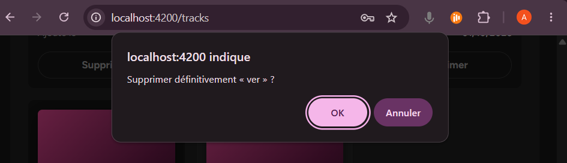

Requête `DELETE` puis rechargement de la page :

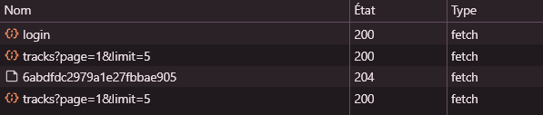

Message de succès :

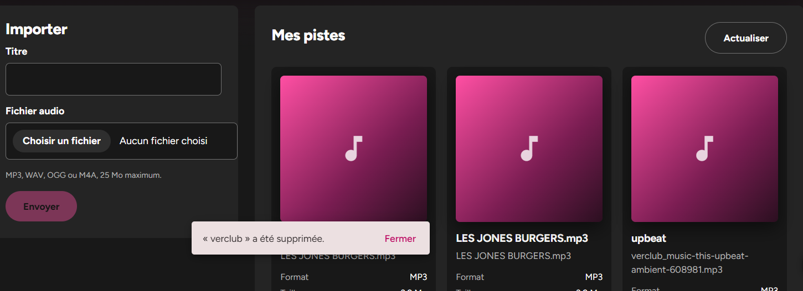

Suppression en cours, boutons désactivés :

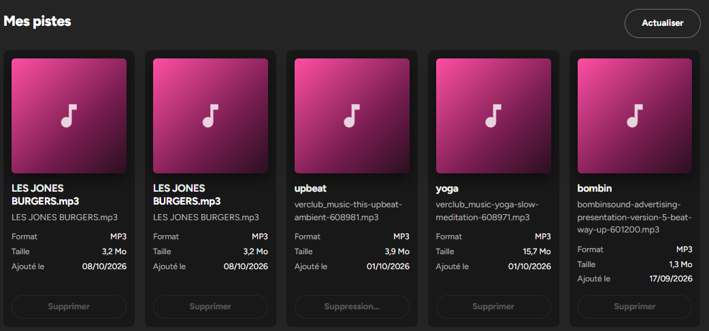

Piste déjà supprimée dans un autre onglet :

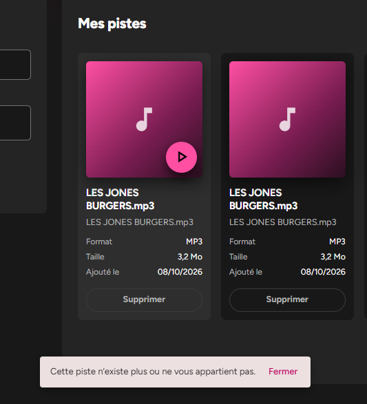

Backend arrêté :

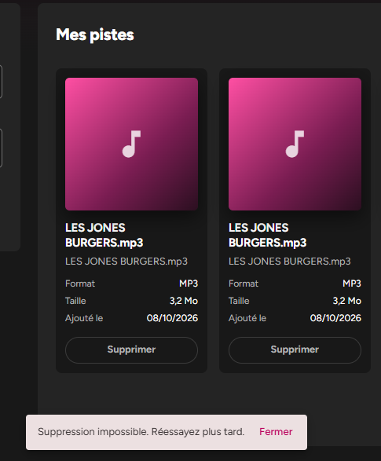

---

## Mission 6 — Progression de l'upload

### Objectif

Faire évoluer l'upload existant pour afficher sa progression, à partir des événements HTTP d'Angular. Il faut distinguer au minimum quatre états : aucun upload en cours, upload en cours avec un pourcentage, réussite et échec. Pendant l'envoi, les contrôles sont désactivés et une seconde soumission est impossible. Le mot de passe et le JWT ne doivent jamais apparaître, ni dans la console ni dans l'interface.

### Prompts principaux

Deux prompts, dans cet ordre.

**1. Analyse sans modification**

> Tu es mon assistant pour ce projet Angular 22. Lis frontend-starter/CLAUDE.md, AGENTS.md, best-practices.md et API_CONTRACT.md (section POST /api/tracks).
>
> - Analyse l'upload existant dans tracks-page.ts/html et track.service.ts. Décris le flux actuel : sélection du fichier → validation → FormData → TrackService → HttpClient → backend, et dis ce qui se passe aujourd'hui pendant l'envoi.
> - Explique ce qu'il faut changer pour suivre la progression : reportProgress: true, observe: 'events', puis les types HttpEventType.Sent, UploadProgress et Response. Explique aussi le calcul du pourcentage avec loaded / total et le cas où total est absent.
> - Propose une modélisation de l'état avec un seul signal, par exemple un type union idle | uploading (avec le pourcentage) | success | error (avec le message), plutôt que plusieurs booléens qui peuvent se contredire. Justifie ton choix.
> - Dis-moi quels contrôles désactiver pendant l'envoi (champ titre, choix du fichier, bouton « Envoyer ») et comment empêcher une seconde soumission, y compris avec la touche Entrée.
> - Liste tous les console.* du frontend et vérifie qu'aucun n'affiche le mot de passe, le JWT, l'en-tête Authorization ou un objet complet qui pourrait les contenir (requête, HttpErrorResponse, formulaire de connexion…).
> - Dis-moi s'il faut recharger la liste des pistes après la réussite et comment remettre le formulaire à zéro.
>
> Contraintes : le composant ne doit jamais appeler HttpClient directement, et le backend ne doit pas être modifié. Ne modifie aucun fichier et attends ma validation.

**2. Implémentation limitée à quatre fichiers**

> J'ai validé l'analyse. Implémente la progression uniquement dans track.service.ts, tracks-page.ts, tracks-page.html (et tracks-page.css si besoin).
>
> TrackService : la méthode d'upload renvoie le flux des HttpEvent (reportProgress: true, observe: 'events'). Le token reste ajouté par l'intercepteur.
> Composant : un signal d'état idle / uploading / success / error. Pour UploadProgress, calcule le pourcentage (si total est absent, affiche « Envoi en cours… » sans pourcentage). Pour Response, passe en réussite, réinitialise le formulaire et recharge la liste. Une erreur passe en échec avec un message adapté au statut (400 format refusé, 401 session expirée, 413 fichier trop gros, 0 serveur injoignable, autre).
> Affichage : une barre <progress> ou mat-progress-bar avec le pourcentage et aria-valuenow, un message de réussite et un message d'erreur. Les contrôles sont désactivés pendant l'envoi, et submit() sort immédiatement si un upload est déjà en cours.
> N'affiche jamais le mot de passe ni le JWT, ni en console ni dans l'interface. Dans les logs, garde seulement le statut et le nom du fichier.
> Respecte les conventions du projet : signals, @if/@switch, inject(), pas de any.
> Montre-moi ensuite le diff avec une explication ligne par ligne, puis la liste des tests à faire dans le navigateur : gros fichier avec le throttling « Slow 3G » dans DevTools, double clic sur « Envoyer », backend arrêté pendant l'envoi, fichier refusé, puis une recherche de Bearer et password dans la console.

### Pourquoi un upload avec progression ne se traite pas comme une requête classique

Une requête classique (`http.post<Track>(…)`) émet **une seule valeur**, le corps de la réponse, puis se termine. Le `next` reçoit directement un `Track`.

Avec `observe: 'events'` et `reportProgress: true`, l'Observable émet **plusieurs valeurs** de types différents (`HttpEvent<Track>`) pendant toute la durée de la requête :

| Événement | Quand | Contenu utile |
|---|---|---|
| `Sent` | La requête part | rien |
| `UploadProgress` | Plusieurs fois pendant l'envoi | `loaded` (octets envoyés) et `total` (taille totale, parfois absente) |
| `ResponseHeader` | Les en-têtes de la réponse arrivent | statut, en-têtes |
| `DownloadProgress` | Pendant la réception de la réponse | sans intérêt ici |
| `Response` | Fin, une seule fois | `status` et `body` (le `Track` créé) |

Conséquences dans le code :

- Le `next` est appelé plusieurs fois. Il faut **tester `event.type`** pour savoir quoi faire. On ne doit traiter la réussite **que** sur `Response`, pas au premier événement reçu.
- Le corps n'est plus reçu directement : il se trouve dans `event.body`, qui peut être `null` selon son type.
- Le pourcentage se calcule : `Math.round(100 * loaded / total)`. Si `total` est absent, on ne peut pas calculer de pourcentage.
- 100 % ne veut pas dire « terminé » : tous les octets sont partis, mais le serveur doit encore écrire le fichier et créer la piste dans MongoDB avant de répondre. Le vrai signal de fin est `Response`.
- Les erreurs, elles, arrivent toujours dans le callback `error`, comme pour une requête classique.

### Diff appliqué

[track.service.ts](frontend-starter/src/app/shared/services/track.service.ts#L18-L31) :

```diff
-    return this.http.post<Track>('/api/tracks', body);
+    return this.http.post<Track>('/api/tracks', body, {
+      reportProgress: true,
+      observe: 'events',
+    });
```

[tracks-page.ts](frontend-starter/src/app/components/tracks-page/tracks-page.ts) :

```diff
+type UploadState = 'idle' | 'uploading' | 'success' | 'error';
 ...
-  readonly uploading = signal(false);
-  readonly uploadError = signal<string | null>(null);
-  readonly uploadSuccess = signal<string | null>(null);
+  readonly uploadState = signal<UploadState>('idle');
+  readonly uploadProgress = signal<number | null>(null);
+  readonly uploadMessage = signal<string | null>(null);
+  readonly uploading = computed(() => this.uploadState() === 'uploading');
 ...
   upload(): void {
     const file = this.file();
     if (!file || this.uploading()) return;
+    const title = this.title.value.trim() || file.name;
+    this.uploadState.set('uploading');
+    this.uploadProgress.set(0);
+    this.uploadMessage.set(null);
+    this.title.disable();
+    console.debug('[TracksPage] Envoi démarré', file.name);
+
+    this.service.upload(file, title).subscribe({
+      next: (event) => {
+        if (event.type === HttpEventType.UploadProgress) {
+          this.uploadProgress.set(event.total ? Math.round((100 * event.loaded) / event.total) : null);
+        } else if (event.type === HttpEventType.Response) {
+          console.debug('[TracksPage] Envoi terminé', event.status, file.name);
+          this.uploadState.set('success');
+          this.uploadMessage.set(`« ${event.body?.title ?? title} » a bien été ajouté.`);
+          this.title.enable();
+          this.title.setValue('');
+          this.clearFile();
+          this.page.set(1);
+          this.load();
+        }
+      },
+      error: (error: unknown) => {
+        const status = error instanceof HttpErrorResponse ? error.status : 0;
+        console.error('[TracksPage] Envoi impossible', status, file.name);
+        this.uploadState.set('error');
+        this.uploadMessage.set(this.uploadErrorMessage(error, status));
+        this.title.enable();
+      },
+    });
   }
+
+  private uploadErrorMessage(error: unknown, status: number): string {
+    switch (status) {
+      case 0: return 'Serveur injoignable. Vérifiez que le backend est lancé.';
+      case 400:
+        if (this.serverMessage(error, '') === 'File too large') return 'Fichier trop volumineux : 25 Mo maximum.';
+        return `Fichier refusé : ${this.serverMessage(error, 'format non accepté')}.`;
+      case 401: return 'Session expirée. Reconnectez-vous.';
+      case 413: return 'Fichier trop volumineux : 25 Mo maximum.';
+      default: return 'Envoi impossible. Réessayez.';
+    }
+  }
```

[tracks-page.html](frontend-starter/src/app/components/tracks-page/tracks-page.html#L12-L53) :

```diff
-        <input #fileInput type="file" accept=".mp3,.wav,.ogg,.m4a" (change)="choose($event)" />
+        <input #fileInput type="file" accept=".mp3,.wav,.ogg,.m4a" (change)="choose($event)"
+          [disabled]="uploading()" />
 ...
-      @if (uploadError()) { <p class="error" role="alert">{{ uploadError() }}</p> }
-      @if (uploadSuccess()) { <p class="success" role="status">{{ uploadSuccess() }}</p> }
+      @switch (uploadState()) {
+        @case ('uploading') {
+          @let percent = uploadProgress();
+          <div class="upload-progress">
+            @if (percent !== null) {
+              <progress max="100" [value]="percent" [attr.aria-valuenow]="percent"
+                aria-valuemin="0" aria-valuemax="100" aria-label="Progression de l'envoi"></progress>
+              <span>{{ percent }} %</span>
+            } @else {
+              <progress aria-label="Progression de l'envoi"></progress>
+            }
+          </div>
+          <p role="status">{{ percent === 100 ? 'Enregistrement par le serveur…' : 'Envoi en cours…' }}</p>
+        }
+        @case ('success') { <p class="success" role="status">{{ uploadMessage() }}</p> }
+        @case ('error') { <p class="error" role="alert">{{ uploadMessage() }}</p> }
+      }
```

[tracks-page.css](frontend-starter/src/app/components/tracks-page/tracks-page.css#L5-L7) :

```diff
+.upload-progress { display: flex; align-items: center; gap: 0.6rem; }
+
+.upload-progress progress { flex: 1; height: 0.8rem; accent-color: #1d755e; }
```

Explication des choix :

- **`observe: 'events'` et `reportProgress: true`** : la première option fait émettre tous les événements HTTP au lieu du seul corps final. La seconde fait générer à Angular les événements `UploadProgress`. Le JWT reste ajouté par l'intercepteur.
- **Type union `UploadState`** : l'envoi ne peut être que dans un état à la fois, et TypeScript refuse toute autre valeur.
- **`uploading` en `computed()`** : déduit de l'état, il ne peut jamais le contredire. La garde contre le double envoi et le template l'utilisent sans changement.
- **Un seul `uploadMessage`** : c'est l'état qui décide s'il s'affiche comme une réussite ou comme une erreur. Les deux messages ne peuvent plus s'afficher ensemble.
- **Titre lu avant `title.disable()`**, puis réactivé par `enable()` à la fin, en cas de réussite comme d'échec. Avec les Reactive Forms, on désactive un champ par code. Un attribut `[disabled]` sur un `[formControl]` provoquerait un avertissement Angular.
- **`[disabled]` sur `<input type="file">`** : correct ici, car ce champ natif n'est pas un `formControl`.
- **`event.type`** : TypeScript affine le type de `event`. Dans la branche `UploadProgress`, on a accès à `loaded` et `total`. Dans la branche `Response`, à `status` et `body`.
- **`total` absent ou nul** : `null`, donc une barre sans pourcentage et pas de division par zéro.
- **`error: unknown` et `instanceof HttpErrorResponse`** : on lit le statut sans `any`.
- **Logs réduits au statut et au nom du fichier** : avant, l'objet d'erreur complet était affiché.
- **`@let percent`** : le signal est lu une fois. `@if (percent !== null)` peut alors en déduire que `percent` est un nombre. `@if (…; as p)` n'aurait pas marché, car `0` est une valeur fausse en JavaScript : la barre ne se serait pas affichée au début de l'envoi.
- **`<progress>` sans `value`** quand la taille est inconnue : le navigateur affiche une barre animée sans pourcentage.
- **`aria-valuenow`** : demandé dans le prompt. Il est redondant avec `<progress>`, qui expose déjà sa valeur, mais sans risque.
- **`role="status"` sur le texte, pas sur le pourcentage** : le lecteur d'écran annonce « Envoi en cours… », puis « Enregistrement par le serveur… », au lieu de lire chaque pourcentage.
- **`accent-color`** : la barre reprend le vert `#1d755e` des boutons.

### Vérifications réalisées

- `npm run build` : compilation sans erreur (lancé par l'agent).
- Recherche par l'agent de tous les `console.*` de `src/app` contenant token, password, bearer ou authorization. Seul résultat : un texte fixe de l'intercepteur (« Token refusé par l'API »), sans la valeur du token.
- Relecture du backend ([app.js:100-120](backend/src/app.js#L100-L120) et [app.js:445-450](backend/src/app.js#L445-L450)) : un fichier trop gros donne un `400 « File too large »`, pas un `413`.

Tests effectués dans le navigateur :

- **Gros fichier en « Slow 3G »** (Network > menu de throttling) : la barre avance avec le pourcentage. Le titre, le champ fichier et « Envoi… » sont grisés. À 100 % : « Enregistrement par le serveur… », puis message de réussite, formulaire vidé, nouvelle card en page 1, champs réactivés. Un seul `POST /api/tracks` en `201`
- **Double clic sur « Envoyer »** en « Slow 3G » : une seule ligne `POST` dans Network
- **Backend arrêté pendant l'envoi** (Ctrl+C sur le backend pendant que la barre avance) : message d'erreur (« Serveur injoignable » si statut `0`, sinon « Envoi impossible. Réessayez. »), champs réactivés
- **Fichier refusé** : un `.txt` ou un `.png` affiche « Format non accepté » sans requête dans Network. Côté serveur, le `fetch` du rapport TP2 renvoie `400` dans Network ; comme il ne passe pas par le composant, aucun message n'apparaît à l'écran
- **Console filtrée** sur `Bearer`, `password` et `eyJ` (début de tout JWT), après une connexion, un upload réussi et un upload en échec : aucun résultat. Même recherche dans le texte de la page

### Erreurs ou propositions rejetées

- **Le `413` demandé n'arrive jamais avec ce backend.** Multer refuse un fichier de plus de 25 Mo avec une erreur que le gestionnaire central transforme en `400 {"message":"File too large"}`. L'agent l'a relevé en relisant [app.js](backend/src/app.js) avant de coder. Il a gardé le cas `413` (un serveur placé devant le backend en production pourrait le renvoyer) et ajouté une détection du `400 « File too large »`. Sans cela, ce `400` aurait affiché « format refusé ». En pratique, un tel fichier est déjà bloqué par `choose()` avant l'envoi.
- **`submit()` non créée** : le prompt parlait de `submit()`, mais la méthode existante s'appelle `upload()`, et le template comme le rapport du TP2 l'utilisent déjà. Elle a gardé son nom, avec le comportement demandé (sortie immédiate si un envoi est en cours).
- **Ajout de l'agent non prévu dans le prompt** : le message « Enregistrement par le serveur… » à 100 %. Sans lui, la barre resterait pleine sans explication pendant que le serveur écrit le fichier et crée la piste.
- **`mat-progress-bar` non retenu** : la balise native `<progress>` suffit, est accessible sans configuration et n'ajoute aucun import au composant.

### Fichiers effectivement modifiés

| Fichier | Changement |
|---|---|
| [track.service.ts](frontend-starter/src/app/shared/services/track.service.ts) | `upload()` renvoie les `HttpEvent` (`reportProgress`, `observe: 'events'`) |
| [tracks-page.ts](frontend-starter/src/app/components/tracks-page/tracks-page.ts) | Type `UploadState`, signaux `uploadState`, `uploadProgress` et `uploadMessage`, `uploading` en `computed()`, `upload()` réécrite, nouvelle méthode `uploadErrorMessage()`, logs réduits |
| [tracks-page.html](frontend-starter/src/app/components/tracks-page/tracks-page.html) | Champ fichier désactivé pendant l'envoi, `@switch` sur l'état, barre `<progress>` |
| [tracks-page.css](frontend-starter/src/app/components/tracks-page/tracks-page.css) | Mise en page de la barre de progression |

Non modifiés : [auth.interceptor.ts](frontend-starter/src/app/shared/interceptors/auth.interceptor.ts), `API_CONTRACT.md` et tout le backend.

### Preuve de fonctionnement

Progression pendant l'envoi :

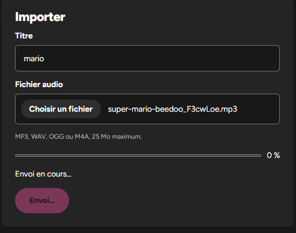

Réussite :

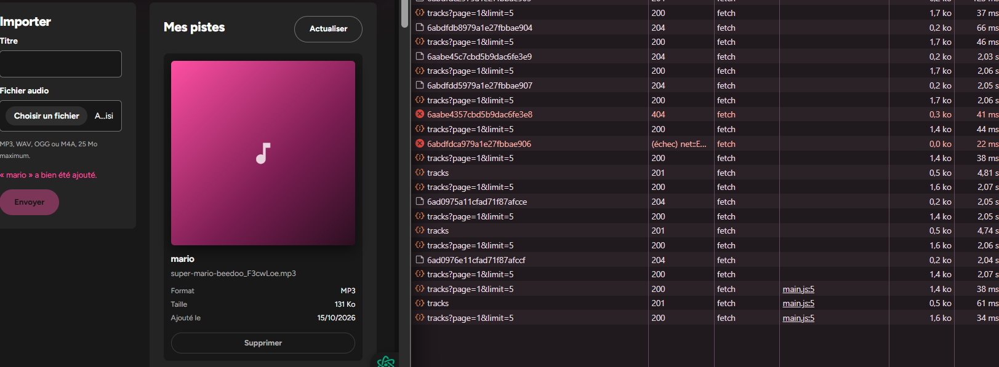

Échec, backend arrêté :

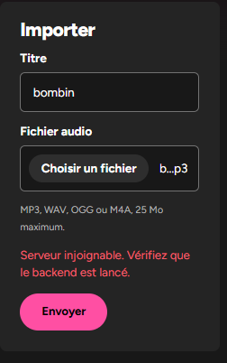

Console sans donnée sensible :

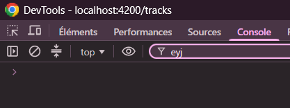

---

## Mission 7 — Tests automatisés

### Objectif

Écrire au moins trois tests frontend ciblés. Ils doivent vérifier les URL, méthodes, paramètres, en-têtes et résultats simulés, sans dépendre d'un backend ni d'une base MongoDB en fonctionnement. J'ai choisi cinq des sept tests proposés par le sujet :

- `TrackService.list()` transmet `page` et `limit` ;
- l'intercepteur ajoute `Authorization` lorsqu'un token existe ;
- le guard redirige un utilisateur sans token ;
- la suppression appelle `DELETE /api/tracks/:id` et recharge la liste ;
- l'upload met à jour l'état de progression et traite l'erreur.

Le code de l'application et le backend ne devaient pas être modifiés.

### Prompts principaux

Deux prompts, dans cet ordre.

**1. Analyse sans modification**

> Tu es mon assistant pour ce projet Angular 22. Lis frontend-starter/CLAUDE.md, AGENTS.md, best-practices.md, la Mission 7 de SUJET_ETUDIANT_TP3.md et API_CONTRACT.md.
>
> Vérifie comment les tests sont configurés : le builder @angular/build:unit-test dans angular.json, le script npm test, le runner (Vitest ?) et les dépendances déjà installées. Indique s'il manque un paquet, avec la commande à lancer, sans l'exécuter.
>
> Lis track.service.ts, auth.service.ts, auth.interceptor.ts, auth.guard.ts et tracks-page.ts. Pour chacun des tests ci-dessous, dis-moi quel fichier .spec.ts créer, quels providers utiliser (provideHttpClient, provideHttpClientTesting, withInterceptors, provideRouter…) et quelles assertions précises écrire (URL, méthode, paramètres, en-têtes, corps, résultat simulé) :
>
> - TrackService.list() transmet page et limit ;
> - l'intercepteur ajoute Authorization: Bearer <token> quand un token existe, et ne l'ajoute pas sinon ;
> - le guard redirige vers /login un utilisateur sans token ;
> - la suppression appelle DELETE /api/tracks/:id après confirmation, puis recharge la liste. Pas de requête si on annule ;
> - l'upload met à jour la progression (UploadProgress puis Response) et passe en erreur sur un échec HTTP.
>
> Pour les tests du composant, explique comment simuler confirm() et MatSnackBar, et comment vérifier les signaux (deletingId, uploadState, uploadProgress).
>
> Contraintes : aucun test ne doit dépendre du backend ni de MongoDB, toutes les réponses HTTP sont simulées avec HttpTestingController, et chaque test se termine par httpMock.verify(). Pas de any, et aucun vrai token dans le code des tests. Ne modifie aucun fichier, et attends ma validation.

**2. Écriture des tests et exécution**

> J'ai validé l'analyse. Crée uniquement les fichiers .spec.ts prévus, à côté des fichiers testés. Ne modifie pas le code de l'application. Si un test révèle un bug, signale-le-moi au lieu de le corriger.
>
> Chaque test doit vérifier au moins une assertion utile (URL, méthode, paramètre, en-tête ou état final), pas seulement que le composant est créé.
>
> Lance npm test, puis npm run build, et montre-moi le résultat complet. Lance aussi les tests du backend (npm test dans backend/) sans les modifier.
>
> Donne-moi ensuite un tableau avec une ligne par test : nom, ce qu'il vérifie, résultat attendu, résultat observé. Ajoute une explication courte pour l'oral.

### Analyse produite par l'agent

**Configuration des tests constatée**

| Élément | Constat |
|---|---|
| [angular.json](frontend-starter/angular.json) | Cible `test` avec le builder `@angular/build:unit-test`, sans option. Le runner par défaut est **Vitest**, dans Node avec un DOM simulé. Les fichiers retenus sont `**/*.spec.ts` |
| [package.json](frontend-starter/package.json) | Script `"test": "ng test --watch=false"`, `vitest` 4.1.11 installé |
| Fichiers existants | Aucun `*.spec.ts` ni `tsconfig.spec.json` |
| **Paquet manquant** | Pas de DOM simulé (`jsdom` ou `happy-dom`). Commande donnée sans être lancée : `npm install --save-dev jsdom` |
| Configuration TypeScript | Sans `tsconfig.spec.json`, le builder reprend [tsconfig.app.json](frontend-starter/tsconfig.app.json), qui a `"types": []` : `describe`, `it` et `expect` ne seraient pas typés comme variables globales |

**Choix proposés et retenus**

| Question | Choix | Raison |
|---|---|---|
| Simuler le serveur | `provideHttpClient()` + `provideHttpClientTesting()`, puis `HttpTestingController` | Aucune requête ne quitte Angular. Le test lit la requête émise et choisit la réponse avec `flush()`, `event()` ou `error()` |
| Vérifier qu'il ne reste rien | `httpMock.verify()` dans `afterEach` | Il s'exécute à la fin de **chaque** test. Il échoue si une requête est inattendue ou n'a pas reçu de réponse |
| Tester l'intercepteur | `withInterceptors([authInterceptor])`, puis appel direct de `HttpClient` | On isole l'intercepteur : aucun service n'intervient |
| Tester le guard | `RouterTestingHarness` avec deux routes de test (`/login` et `/tracks` protégée) | C'est une vraie navigation, sans fabriquer de faux `ActivatedRouteSnapshot` par un cast |
| Token | Constante `FAKE_TOKEN = 'fake-test-token'` | Ce n'est pas un JWT, aucune donnée sensible dans le code |
| `localStorage` | Vidé avant chaque test | `AuthService` lit `gpc_token` **au moment de sa création** : sans ce nettoyage, un token passerait d'un test à l'autre |
| `confirm()` | `vi.spyOn(globalThis, 'confirm').mockReturnValue(true / false)` | jsdom définit `confirm()` sans l'implémenter : sans espion, le test échoue |
| `MatSnackBar` | Remplacé par `{ open: vi.fn<MatSnackBar['open']>() }` | Rien ne s'affiche, mais on vérifie le message, le bouton « Fermer » et la durée. Le type de la fonction est conservé, sans `any` |
| Signaux du composant | Lus directement : `component.deletingId()`, `uploadState()`, `uploadProgress()` | `flush()` répond de façon synchrone : chaque étape intermédiaire est observable, sans `fakeAsync` |

**Piège relevé par l'agent** : le constructeur de `TracksPageComponent` appelle `load()`. Chaque test du composant doit donc d'abord répondre au premier `GET /api/tracks?page=1&limit=5`, sinon `verify()` échoue. De plus, `fixture.detectChanges()` est obligatoire avant un upload réussi, car `clearFile()` utilise `viewChild.required('fileInput')`, qui n'existe qu'après le premier rendu.

### Fichiers de test créés

| Fichier | Tests |
|---|---|
| [track.service.spec.ts](frontend-starter/src/app/shared/services/track.service.spec.ts) | 2 |
| [auth.interceptor.spec.ts](frontend-starter/src/app/shared/interceptors/auth.interceptor.spec.ts) | 4 |
| [auth.guard.spec.ts](frontend-starter/src/app/shared/guards/auth.guard.spec.ts) | 2 |
| [tracks-page.spec.ts](frontend-starter/src/app/components/tracks-page/tracks-page.spec.ts) | 5 |

Extrait représentatif, la suppression confirmée ([tracks-page.spec.ts](frontend-starter/src/app/components/tracks-page/tracks-page.spec.ts)) :

```ts
const confirmSpy = vi.spyOn(globalThis, 'confirm').mockReturnValue(true);

component.remove(trackA);

expect(confirmSpy).toHaveBeenCalledWith(`Supprimer définitivement « ${trackA.title} » ?`);
expect(component.deletingId()).toBe(trackA.id);

const req = httpMock.expectOne({ method: 'DELETE', url: `/api/tracks/${trackA.id}` });
req.flush(null, { status: 204, statusText: 'No Content' });

expect(component.deletingId()).toBeNull();
expect(snackBarMock.open).toHaveBeenCalledWith(`« ${trackA.title} » a été supprimée.`, 'Fermer', { duration: 4000 });

// Rechargement de la page courante.
const reload = httpMock.expectOne('/api/tracks?page=1&limit=5');
expect(reload.request.method).toBe('GET');
reload.flush(fakePage([trackB]));
expect(component.tracks()).toEqual([trackB]);
```

Et la progression de l'upload, simulée événement par événement :

```ts
req.event({ type: HttpEventType.UploadProgress, loaded: 50, total: 100 });
expect(component.uploadProgress()).toBe(50);

req.event({ type: HttpEventType.UploadProgress, loaded: 80 }); // taille totale inconnue
expect(component.uploadProgress()).toBeNull();

req.flush(created, { status: 201, statusText: 'Created' }); // événement Response
expect(component.uploadState()).toBe('success');
```

### Rapport des tests : résultats attendus et observés

Chaque test se termine par `httpMock.verify()` (dans `afterEach`).

| # | Test | Ce qu'il vérifie | Résultat attendu | Observé |
|---|---|---|---|---|
| 1 | `TrackService` : `list(2, 10)` | Méthode, URL, paramètres, corps, résultat simulé | `GET /api/tracks?page=2&limit=10`, `params.get('page') === '2'`, `params.get('limit') === '10'`, corps `null`, résultat égal à la page simulée | ✅ Passe |
| 2 | `TrackService` : `list()` sans argument | Valeurs par défaut | `GET /api/tracks?page=1&limit=5` | ✅ Passe |
| 3 | Intercepteur avec token | En-tête ajouté | `Authorization: Bearer fake-test-token` | ✅ Passe |
| 4 | Intercepteur sans token | En-tête absent | `headers.has('Authorization') === false` | ✅ Passe |
| 5 | Intercepteur : `401` sur `/api/users/me` | Erreur relancée, session vidée, redirection | Statut `401` reçu par l'appelant, `token()` vaut `null`, `navigateByUrl('/login')` appelé | ✅ Passe |
| 6 | Intercepteur : `401` sur `/api/auth/login` | Un mauvais mot de passe ne déconnecte pas | Token conservé, aucune navigation | ✅ Passe |
| 7 | Guard sans token | Redirection | Navigation vers `/tracks`, arrivée sur `/login`, aucune requête HTTP | ✅ Passe |
| 8 | Guard avec token | Accès autorisé | `router.url === '/tracks'` | ✅ Passe |
| 9 | Suppression confirmée | Confirmation, `deletingId`, `DELETE`, SnackBar, rechargement | Message de `confirm` avec le titre. `deletingId = 'a1'` et bouton « Suppression… » pendant la requête. `DELETE /api/tracks/a1` → `204` → `deletingId = null`, SnackBar de succès (« Fermer », 4000 ms). Puis `GET ?page=1&limit=5` et la liste ne contient plus que la piste B | ✅ Passe |
| 10 | Suppression annulée | Aucune requête si on annule | Aucun `DELETE` ni `GET`, `deletingId = null`, pas de SnackBar, liste inchangée | ✅ Passe |
| 11 | Upload réussi | Corps multipart, progression, réponse finale | `POST /api/tracks` avec `reportProgress`. `FormData` avec `title = 'Démo'` et `audio = demo.mp3`. État `uploading`, progression 0 → 50 → `null`. `201` → `success`, message « « Démo » a bien été ajouté. », formulaire vidé et réactivé, rechargement de la page 1 | ✅ Passe |
| 12 | Upload en erreur `400` | Gestion de l'erreur | État `error`, message « Fichier refusé : Invalid file type. », titre réactivé, fichier conservé, aucun rechargement | ✅ Passe |
| 13 | Upload en erreur réseau (statut `0`) | Serveur injoignable | État `error`, message « Serveur injoignable. Vérifiez que le backend est lancé. » | ✅ Passe |

Les tests n'ont révélé **aucun bug** dans le code de l'application.

### Vérifications réalisées

Commandes lancées par l'agent :

**Frontend** : `npm test -- --build-target=gpc:build --reporters=verbose` (voir plus bas pourquoi l'option est nécessaire)

```
 Test Files  4 passed (4)
      Tests  13 passed (13)
   Duration  2.68s
```

La capture ci-dessous a été prise plus tard, alors que le TP4 était déjà commencé : elle montre `10 passed (10)` fichiers et `69 passed (69)` tests. Les 13 tests du TP3 en font partie. Les autres viennent du TP4 (forme d'onde, VU-mètres, pagination Material) et ont été ajoutés dans de nouvelles specs ou dans `tracks-page.spec.ts`.

**Build** : `npm run build`

```
✔ Building...
main.js     | main   | 442.61 kB | 109.73 kB
styles.css  | styles |   9.54 kB |   1.84 kB
Application bundle generation complete.
```

Sur la capture, prise au même moment que celle des tests, `main.js` pèse 658,95 kB au lieu de 442,61 kB : le code du TP4 (forme d'onde, VU-mètres, paginator Material) y est déjà inclus. Le build passe toujours sans erreur.

**Backend** : `npm test` dans `backend/`, sans modification

```
✔ health sans dépendre de MongoDB
✔ schémas Mongoose et relation
ℹ tests 2 | pass 2 | fail 0
```

L'extension backend facultative (tests `401`, upload sans fichier, type MIME refusé, etc.) n'a pas été réalisée.

### Erreurs ou propositions rejetées

- **`jsdom` manquant** : le premier `npm test` s'est arrêté avant toute compilation (« A DOM environment is required for non-browser tests »). L'agent m'a demandé mon accord avant d'installer le paquet, puis a lancé `npm install --save-dev jsdom` (version 30.1.2).
- **`npm test` seul ne fonctionne toujours pas** : le builder `unit-test` cherche par défaut la configuration `gpc:build:development`, qui n'existe pas dans [angular.json](frontend-starter/angular.json). Erreur : `Configuration 'development' for target 'build' in project 'gpc' is not set`. Comme je n'avais autorisé que la création des specs, l'agent n'a pas modifié `angular.json`. Il a passé la cible en option de ligne de commande : `npm test -- --build-target=gpc:build`. La correction durable serait d'ajouter `"options": { "buildTarget": "gpc:build" }` à la cible `test`.
- **`tsconfig.spec.json` non créé** : l'agent l'avait proposé dans l'analyse. Pour rester sur « uniquement les fichiers .spec.ts », chaque spec importe `describe`, `it`, `expect` et `vi` depuis `'vitest'`, sans dépendre de types globaux. Les specs restent incluses dans la vérification des types de `npm run build` (à cause de `src/**/*.ts` dans `tsconfig.app.json`), et le build passe quand même.
- **Tests ajoutés par l'agent au-delà de ma demande** : le `401` de l'intercepteur (session vidée et redirection), le `401` sur `/api/auth/login` (pas de déconnexion), le guard **avec** token, et l'upload en erreur réseau (statut `0`). Je les ai gardés : ils vérifient chacun un comportement réel, et le `401` sur `/api/auth/login` protège la page de connexion.
- **Tests du sujet non réalisés** : `AuthService.login()` et « le composant affiche une erreur après un échec HTTP » au chargement de la liste. Le sujet en demande au moins trois, il y en a cinq.

### Fichiers effectivement modifiés

| Fichier | Changement |
|---|---|
| [track.service.spec.ts](frontend-starter/src/app/shared/services/track.service.spec.ts) | Nouveau : 2 tests de `list()` |
| [auth.interceptor.spec.ts](frontend-starter/src/app/shared/interceptors/auth.interceptor.spec.ts) | Nouveau : 4 tests de l'intercepteur |
| [auth.guard.spec.ts](frontend-starter/src/app/shared/guards/auth.guard.spec.ts) | Nouveau : 2 tests du guard |
| [tracks-page.spec.ts](frontend-starter/src/app/components/tracks-page/tracks-page.spec.ts) | Nouveau : 2 tests de suppression, 3 tests d'upload |
| [package.json](frontend-starter/package.json) et `package-lock.json` | Ajout de `jsdom` en `devDependencies` |

Non modifiés : tout le code de l'application, [angular.json](frontend-starter/angular.json), les fichiers `tsconfig`, `API_CONTRACT.md` et tout le backend.

### Preuve de fonctionnement

Tests frontend :

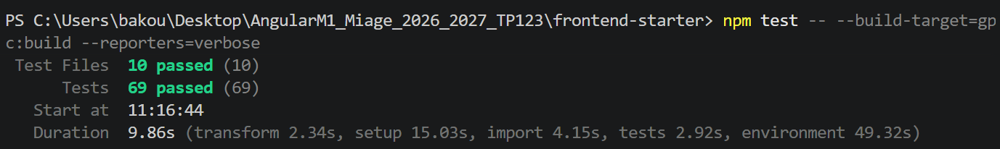

Build :

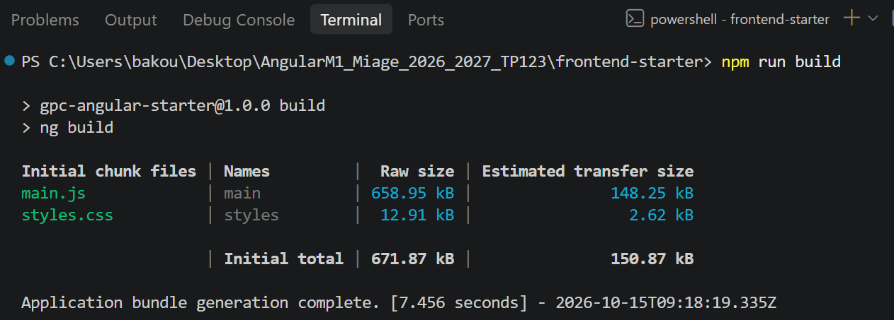

### Explications pour l'oral (produites par l'agent)

**Pourquoi ces tests n'ont pas besoin de MongoDB.** Avec `provideHttpClientTesting()`, aucune requête ne quitte Angular. `HttpTestingController` les intercepte, et c'est le test qui choisit la réponse avec `flush(...)` ou `error(...)`. Le backend n'est jamais contacté, et MongoDB encore moins. On teste ce que le frontend **envoie** (URL, méthode, en-têtes, corps) et ce qu'il **fait** de la réponse (signaux, messages, rechargement).

**Ce que vérifient le test de l'intercepteur et celui du guard.**

- **Intercepteur** : on lit la requête au moment où elle sortirait de l'application. On vérifie que l'en-tête `Authorization: Bearer <token>` est présent s'il y a un token et absent sinon. En complément, une réponse `401` vide la session et redirige vers `/login`, sauf sur `/api/auth/*`.
- **Guard** : on fait une vraie navigation avec le routeur Angular vers une route protégée. On vérifie l'URL d'arrivée : `/login` sans token, `/tracks` avec un token. Le guard ne lit que la présence du token : il ne vérifie pas sa validité, c'est le rôle du backend (voir Mission 5).

**Test unitaire ou test d'intégration.** Ces tests sont unitaires : ils isolent une seule pièce (un service, l'intercepteur, le guard ou le composant). Tout ce qui l'entoure est simulé : le serveur HTTP, `confirm()` et `MatSnackBar`. Ils sont rapides (environ 3 s) et indiquent précisément quelle pièce est fautive. Un test d'intégration fait travailler plusieurs pièces réelles ensemble, par exemple Angular, l'API Express et une vraie base MongoDB. Il vérifie que les pièces fonctionnent bien ensemble, mais il est plus lent et plus fragile à mettre en place. Les tests du backend (`node --test`, qui interroge la vraie route `GET /api/health`) se rapprochent davantage de ce second type.
